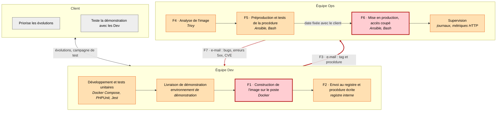

# Rapport d'audit et diagnostic

Amélioration des pratiques DevOps — Projet StarMap

> Statut : à rédiger (structure du modèle fourni par StarSail).

## Synthèse

<!-- À rédiger en dernier : 4 constats et 4 recommandations triées par
priorité, une demi-page. -->

## 1. Introduction et contexte

### 1.1 Présentation de l'entreprise

StarSail Inc. est une entreprise technologique fondée il y a cinq ans,
qui compte une trentaine de collaborateurs. Spécialisée dans la
géolocalisation par traitement d'images astronomiques, elle vise à rendre
la navigation possible dans les zones dépourvues de signal satellite.

Elle est organisée en quatre pôles : Recherche et Développement (R&D),
Développement logiciel (Dev), Opérations et infrastructure (Ops),
Qualité et Amélioration continue (QA).

Son projet phare, StarMap, détermine la position d'un utilisateur à
partir d'une photographie du ciel nocturne. Il est en phase de
pré-production.

StarSail identifie elle-même plusieurs limites dans ses processus :
livraisons manuelles, tests partiels, communication perfectible entre
Dev et Ops, absence d'automatisation complète de la chaîne CI/CD. C'est
dans ce contexte que la Responsable Qualité et Amélioration Continue a
confié cet audit au Responsable DevOps, avec un objectif : améliorer la
qualité, la sécurité et la rapidité des déploiements.

### 1.2 Périmètre de l'audit

L'audit porte sur la chaîne de livraison de StarMap, depuis le poste du
développeur jusqu'à la mise en production : construction, tests,
contrôles de sécurité, déploiement et supervision.

**Périmètre technique**

| Élément | Description |
|---|---|
| Environnement de développement | Postes des développeurs, Docker Compose, PostgreSQL |
| Environnement de test / préproduction (staging) | Serveur Debian « iso-production » ; il est supposé héberger aussi l'environnement de démonstration utilisé avec le client, absent du schéma d'infrastructure |
| Environnement de production | Serveur Debian, conteneurs déployés par Ansible et des scripts Bash, supervision des journaux et des métriques HTTP |
| Outils transverses | Registre Docker interne, Trivy, Git |

**Périmètre organisationnel**

| Acteur | Rôle dans la chaîne |
|---|---|
| Équipe Dev (4 personnes) | Développement, tests, construction des images, rédaction de la procédure de déploiement |
| Équipe Ops (2 personnes) | Analyse de sécurité, tests, déploiement, supervision |
| Client | Priorisation, campagnes de test, choix de la date de mise en production |

**Hors périmètre** : la version mobile de StarMap, citée sans aucune
description ; le modèle d'intelligence artificielle et le pôle R&D ;
l'architecture de l'application (par exemple l'ajout d'un cache Redis) ;
les processus internes du client.

## 2. Méthodologie d'audit

### 2.1 Sources d'information

- Le document « Projet StarMap – Équipes et processus DevOps actuels » :
  présentation de l'entreprise et de l'infrastructure, questionnaires des
  équipes Dev et Ops, schéma d'infrastructure, frise du cycle DevOps et
  schéma des échanges entre le client, les Dev et les Ops (étapes E1 à
  E14).
- La demande de la Responsable Qualité et Amélioration Continue et les
  modèles de rapport fournis.
- Pour la veille : documentations officielles des outils, comparatifs,
  retours d'expérience publiés et dates de fin de support
  (endoflife.date).
- L'expérience de l'auditeur sur des projets antérieurs : analyse des
  images avec Trivy, contrôle des Dockerfile avec Hadolint, audit des
  dépendances, tests de bout en bout avec Cypress et tests de charge avec
  k6 ; puis chaîne CI/CD sous GitHub Actions avec SonarQube, Trivy,
  Gitleaks, Dependabot et mesure des indicateurs DORA.

### 2.2 Démarche d'analyse

L'audit a suivi cinq étapes :

1. Analyse des documents et définition du périmètre.
2. Cartographie du pipeline actuel (diagramme AS-IS).
3. Analyse SWOT, puis priorisation des constats selon leur impact sur la
   qualité, la sécurité et les délais.
4. Veille technologique ciblée sur les besoins identifiés.
5. Formulation de recommandations stratégiques.

Deux règles ont été appliquées tout au long de l'audit :

- **Règle de preuve** : chaque constat cite le document et la page dont
  il provient ; ce qui n'est pas documenté est présenté comme une
  hypothèse.
- **Traçabilité** : chaque point de friction reçoit un numéro (F1, F2…)
  repris dans l'analyse SWOT, les constats et les recommandations.

Les risques de sécurité sont analysés à l'aide de référentiels publics :
l'OWASP Top 10 (risques des applications web) et l'OWASP Top 10 des
risques CI/CD (risques des chaînes d'intégration et de déploiement).

Une IA (Claude, d'Anthropic) a été utilisée comme assistant pour relire
les documents, proposer des formulations et vérifier la cohérence.
L'analyse, les choix et le contenu final ont été décidés par l'auditeur.

## 3. État des lieux technique

### 3.1 Infrastructure et stack technologique

StarMap est hébergé sur deux serveurs Debian, l'un de test et
préproduction, l'autre de production, auxquels s'ajoutent les postes des
développeurs. Les images Docker sont stockées dans un registre interne
partagé et analysées avec Trivy avant chaque déploiement.

Le tableau suivant reprend les technologies citées par les équipes, leur
rôle dans la chaîne, leur niveau déclaré dans les questionnaires et l'état
de leur fin de support (source : endoflife.date, consulté le 17/11/2026).

| Technologie | Rôle dans la chaîne | Équipe | Niveau déclaré | Version documentée | Fin de support |
|---|---|---|---|---|---|
| PHP / Symfony | Langage et framework du backend | Dev | Très bon | « PHP 8 » ; Symfony non précisé | PHP 8.0 et 8.1 terminés ; 8.2 jusqu'au 31/12/2026 ; 8.3 à 8.5 maintenus |
| TypeScript / Stimulus | Interface web (front-end) | Dev | Bon | non précisée | — |
| Composer / NPM | Gestion des dépendances PHP et JavaScript | Dev | Bon | non précisée | Node.js 22, 24 et 26 maintenus |
| PHPUnit / Jest | Tests unitaires et d'intégration | Dev | Très bon / Moyen | non précisée | — |
| Docker Compose / Docker | Environnement de développement ; images et conteneurs en préproduction et en production | Dev / Ops | Moyen / Bon | non précisée | Docker Engine 29 maintenu ; 25.0 jusqu'au 04/12/2026 |
| PostgreSQL | Base de données (catalogue d'étoiles) | Dev et Ops | Moyen | non précisée | 14 terminé le 12/11/2026 ; 15 à 18 maintenus |
| Debian | Système des deux serveurs | Ops | Bon | « stable » | 13 (stable) maintenue ; 12 en support étendu jusqu'au 30/06/2028 |
| Apt | Gestion des paquets des serveurs Debian | Ops | Bon | — | — |
| Bash / Ansible | Configuration des serveurs et déploiement des conteneurs | Ops | Très bon / Bon | non précisée | — |
| TestInfra / BashUnit | Tests d'infrastructure | Ops | Bon | non précisée | — |
| Trivy | Analyse des failles (CVE) de l'image avant déploiement | Ops | non indiqué | non précisée | — |
| Git, VS Code | Gestion des versions du code ; éditeur | Dev | non indiqué | — | — |

### 3.2 Processus de développement et déploiement

*Figure 1 – Pipeline actuel de StarMap (AS-IS).*

| Repère | Signification |
|---|---|
| Orange | Étape manuelle |
| Rouge (cadre épais) | Étape manuelle et point de friction majeur |
| Flèche rouge | Passage de relais par e-mail entre Dev et Ops |
| Gris | Intervention du client |
| F1 à F7 | Points de friction, repris dans les sections 4 à 6 |

Une évolution suit le chemin suivant. Le client priorise les évolutions
avec l'équipe Dev, qui développe et lance les tests unitaires sur ses
postes, puis livre une démonstration testée avec le client. L'image
Docker est ensuite construite sur le poste d'un développeur (F1), envoyée
au registre interne et accompagnée d'une procédure écrite (F2). Le tag de
l'image et la procédure sont transmis aux Ops par e-mail (F3). Les Ops
analysent l'image avec Trivy (F4), la déploient en préproduction et
rejouent les tests de la procédure (F5), puis fixent une date avec le
client et mettent en production en coupant l'accès (F6). Les anomalies
détectées par la supervision, les bugs et les alertes de sécurité
reviennent aux Dev par e-mail (F7).

### 3.3 Analyse des workflows Dev et Ops

**Passages de relais entre équipes**

| Échange | Sens | Canal | Source |
|---|---|---|---|
| Tag de l'image et procédure de déploiement | Dev → Ops | e-mail | p. 3 ; questionnaire Ops p. 7 |
| Bugs ou questions sur la procédure de déploiement | Ops → Dev | e-mail | questionnaires Dev p. 5 et Ops p. 7 |
| Erreurs HTTP 5xx constatées en production | Ops → Dev | e-mail | questionnaire Ops p. 7 |
| Alertes de sécurité (CVE dans l'image en production) | Ops → Dev | e-mail | p. 3 ; questionnaires Dev p. 5 et Ops p. 7 |
| Date de mise en production | Ops ↔ client | non précisé | questionnaire Ops p. 7 |
| Notification de mise en production | Ops → client et Dev | e-mail | questionnaire Ops p. 7 |

Les équipes Dev et Ops citent les trois mêmes types d'échanges : bugs liés
au déploiement, anomalies après la mise en production et alertes de
sécurité. Elles s'accordent donc sur les difficultés. Ces retours passent
par e-mail, « souvent avec retard » (p. 3).

**Tâches manuelles ou réalisées deux fois**

- Les tests sont menés deux fois à la main : d'abord par le client et
  les Dev sur l'environnement de démonstration, puis par les Ops en
  préproduction.
- La procédure de déploiement est rédigée par les Dev, puis rejouée pas
  à pas par les Ops.
- Le tag de l'image est recopié à la main dans un e-mail.

**Aspects humains**

- Le problème de nommage des images est signalé par les Ops dans une
  question réservée aux Dev, avec cette remarque : « Je ne sais pas si les
  développeurs en ont discuté » (questionnaire Ops, p. 6).
- L'équipe Ops compte deux personnes : le Lead Ops, spécialiste de Bash et
  d'Ansible, et un Senior Ops, responsable de la sécurité et de la
  supervision. Côté Dev, l'automatisation (Docker, NPM) est confiée au
  stagiaire (questionnaires Dev p. 4 et Ops p. 6).

## 4. Analyse SWOT

La matrice croise ce qui dépend de StarSail (forces et faiblesses) et ce
qui vient de son environnement (opportunités et menaces). Chaque point est
numéroté et renvoie, quand il y a lieu, aux points de friction F1 à F7 de
la figure 1. Les risques de sécurité figurent dans les faiblesses et les
menaces.

| | Utile | Nuisible |
|---|---|---|
| **Interne** | **Forces** S1 Application conteneurisée, registre interne S2 Préproduction identique à la production S3 Analyse Trivy avant chaque déploiement S4 Ansible et tests d'infrastructure S5 Très bon niveau PHP/Symfony et PHPUnit S6 Équipes coordonnées, démonstration au client, propositions d'outils S7 Supervision de la production | **Faiblesses** W1 Images construites sur les postes (F1) W2 Nommage des images non respecté (F2) W3 Relais et retours par e-mail, avec retard (F3, F7) W4 Tests manuels, partiels et refaits deux fois (F5) W5 Résultats de Trivy non suivis, CVE en production (F4) W6 Mise en production manuelle avec coupure (F6) W7 Aucune preuve de SAST, SCA, signature ni gestion des secrets W8 Versions non inventoriées W9 Savoirs portés par peu de personnes W10 Aucune sauvegarde décrite, un seul serveur de production |
| **Externe** | **Opportunités** O1 Socle existant (Docker, Ansible, registre) O2 Outils CI/CD et de sécurité gratuits ou open source O3 Pratiques DevSecOps et indicateurs DORA O4 Notifications et tickets automatiques O5 Équipes demandeuses d'automatisation | **Menaces** T1 Faille exploitée en production T2 Fin de support d'une brique non inventoriée T3 Attaque par la chaîne d'approvisionnement T4 Déploiement d'une mauvaise version T5 Départ d'une personne clé T6 Perte de réactivité face à la concurrence T7 Perte du serveur de production |

*Figure 2 – Matrice SWOT de la chaîne de livraison de StarMap.*

### 4.1 Forces

- **S1** : l'application est livrée en images Docker, stockées dans un
  registre interne partagé (p. 2).
- **S2** : les Ops testent chaque version sur un environnement
  « iso-production » avant la production (questionnaire Ops, p. 7).
- **S3** : chaque image est analysée avec Trivy avant d'être déployée
  (p. 3).
- **S4** : l'infrastructure est déjà décrite avec Ansible, et les Ops
  maîtrisent des outils de test d'infrastructure, TestInfra et BashUnit
  (questionnaire Ops, p. 6).
- **S5** : l'équipe Dev déclare un très bon niveau en PHP/Symfony et en
  PHPUnit (questionnaire Dev, p. 4).
- **S6** : les équipes travaillent de manière coordonnée (p. 3), le
  client voit une démonstration à mi-itération (questionnaire Dev, p. 5),
  et chaque équipe propose elle-même des outils (Cypress, Redis,
  Kubernetes).
- **S7** : la production est supervisée (journaux et métriques HTTP) et
  les erreurs 5xx sont détectées (schéma p. 8, questionnaire Ops p. 7).

### 4.2 Faiblesses

- **W1** : les images sont construites sur les postes des développeurs,
  sans chaîne d'intégration continue (p. 3) ; leur contenu dépend donc du
  poste qui les a produites.
- **W2** : le nommage (tag) des images « n'est pas toujours respecté »,
  ce qui « peut provoquer des incompréhensions et donc des erreurs au
  moment du déploiement » (questionnaire Ops, p. 6-7).
- **W3** : le travail et les retours (bugs, alertes de sécurité, erreurs)
  circulent par e-mail, « souvent avec retard » (p. 3) ; StarSail juge
  elle-même la communication Dev/Ops « perfectible » (p. 2).
- **W4** : les tests sont qualifiés de « partiels » (p. 2), lancés à la
  main et refaits deux fois (questionnaires Dev p. 5 et Ops p. 7) ; le
  niveau déclaré en Jest est « moyen » (p. 4).
- **W5** : les résultats de Trivy ne sont pas suivis dans un outil (p. 3),
  et des CVE sont signalées dans l'image en production (questionnaires Dev
  p. 5 et Ops p. 7).
- **W6** : la mise en production est manuelle et coupe l'accès à
  l'application pendant l'opération (questionnaire Ops, p. 7).
- **W7** : aucun élément fourni ne montre d'analyse du code (SAST), des
  dépendances Composer et NPM (SCA), de signature des images ni de
  gestion des secrets ; les développeurs envoient eux-mêmes leurs images
  dans le registre partagé (schéma p. 8).
- **W8** : les versions ne sont pas inventoriées (« PHP 8 », « Debian
  stable », PostgreSQL et Symfony sans numéro), ce qui empêche de vérifier
  leur fin de support (section 3.1).
- **W9** : l'équipe Ops compte deux personnes, et l'automatisation côté
  Dev est confiée au stagiaire (questionnaires Dev p. 4 et Ops p. 6).
- **W10** : aucun élément fourni ne décrit de sauvegarde ni de
  restauration de la base PostgreSQL, et la production dispose d'un seul
  serveur (p. 2).

### 4.3 Opportunités

- **O1** : Docker, Ansible et le registre existent déjà ; l'automatisation
  peut s'appuyer sur ce socle au lieu de le remplacer.
- **O2** : de nombreux outils de CI/CD, de test et de sécurité sont
  gratuits ou open source, adaptés à une petite équipe (comparés en
  annexe A).
- **O3** : les pratiques DevSecOps intègrent les contrôles de sécurité dès
  le début de la chaîne, et les indicateurs DORA permettent de mesurer
  les progrès de la livraison.
- **O4** : les alertes peuvent déclencher des notifications (téléphone,
  messagerie) et créer des tickets automatiquement, à la place des
  e-mails.
- **O5** : les équipes demandent déjà des outils d'automatisation : tests
  de bout en bout avec Cypress côté Dev, orchestration avec Kubernetes
  côté Ops (questionnaires Dev p. 5 et Ops p. 7).

### 4.4 Menaces

- **T1** : des CVE étant déjà présentes en production, une faille connue
  peut y être exploitée avant d'être corrigée.
- **T2** : une brique non inventoriée peut avoir atteint sa fin de
  support sans que l'équipe le sache : par exemple, PHP 8.2 n'est plus
  maintenu après le 31/12/2026, et PostgreSQL 14 ne l'est plus depuis le
  12/11/2026 (endoflife.date, consulté le 17/11/2026).
- **T3** : les outils de la chaîne peuvent eux-mêmes être compromis : en
  mars 2026, des versions piégées de Trivy ont volé les secrets de
  chaînes CI (CVE-2026-33634). Ce risque correspond à la catégorie A03 de
  l'OWASP Top 10:2025, « défaillances de la chaîne d'approvisionnement
  logicielle ».
- **T4** : un tag erroné peut conduire à déployer une mauvaise version en
  production.
- **T5** : le départ du stagiaire ou d'un des deux Ops ferait perdre une
  partie des savoirs nécessaires aux livraisons.
- **T6** : des livraisons lentes et des coupures de service réduisent la
  réactivité de StarSail face à ses concurrents.
- **T7** : la perte du serveur de production arrêterait le service ;
  sans sauvegarde testée, des données pourraient être perdues.

## 5. Constats et besoins identifiés

Les faiblesses de la section 4 sont d'abord classées selon leur impact
sur la qualité, la sécurité et les délais. Le niveau est **élevé** quand
le problème touche déjà la production ou peut exposer l'application, et
**moyen** quand il cause des erreurs ou des retards sans exposition
directe.

| Faiblesse | Qualité | Sécurité | Délais | Niveau |
|---|---|---|---|---|
| W1 Images construites sur les postes | ✓ | ✓ | | élevé |
| W2 Tag non respecté, risque d'erreurs de déploiement | ✓ | | ✓ | élevé |
| W3 Relais et retours par e-mail, en retard | | | ✓ | moyen |
| W4 Tests manuels, partiels et refaits deux fois | ✓ | | ✓ | moyen |
| W5 Résultats de Trivy non suivis, CVE en production | | ✓ | | élevé |
| W6 Mise en production manuelle avec coupure | ✓ | | ✓ | moyen |
| W7 Aucune preuve de SAST, SCA, signature ni gestion des secrets | | ✓ | | élevé |
| W8 Versions non inventoriées | | ✓ | | moyen |
| W9 Savoirs portés par peu de personnes | | | ✓ | moyen |
| W10 Aucune sauvegarde décrite, un seul serveur de production | | ✓ | ✓ | élevé |

Les risques de sécurité sont classés de la même façon. Ils couvrent la
confidentialité, l'intégrité et la disponibilité des données. La colonne
« Nature » distingue ce qui est constaté dans les documents de ce
qu'aucun élément fourni ne permet de vérifier.

| Risque de sécurité | Nature | Impact |
|---|---|---|
| CVE dans l'image en production | constaté (questionnaires Dev p. 5, Ops p. 7) | élevé |
| Analyse Trivy non automatisée, résultats non suivis | constaté (p. 3) | élevé |
| Image construite sur un poste et non signée | constaté pour la construction (p. 3) ; non prouvé pour la signature | élevé |
| Tag non maîtrisé | constaté (questionnaire Ops, p. 6-7) | élevé |
| Absence d'analyse du code (SAST) et des dépendances (SCA) | non prouvé | élevé |
| Gestion des secrets | non prouvé | élevé |
| Droits sur le registre : les développeurs y envoient eux-mêmes leurs images | indice (schéma p. 8) | moyen |
| Perte de données ou arrêt prolongé du service | constaté pour le serveur unique (p. 2) ; non prouvé pour la sauvegarde | élevé |

Ces constats sont regroupés en quatre problématiques, présentées par
ordre de priorité.

### 5.1 Problématique 1 – Les failles de sécurité sont découvertes trop tard et ne sont pas suivies

**Constat.** Les Ops analysent chaque image avec Trivy avant de la
déployer, mais les résultats ne sont intégrés à aucun outil de suivi
(p. 3). Les deux équipes signalent pourtant des CVE dans l'image en
production (questionnaires Dev p. 5 et Ops p. 7). Aucun élément ne montre
d'analyse du code, des dépendances Composer et NPM, de signature des
images ni de gestion des secrets (W7). Enfin, les versions utilisées ne
sont pas inventoriées (W8).

**Impact.** Sécurité, niveau élevé : des failles connues sont déjà
présentes en production (T1), une brique peut avoir atteint sa fin de
support sans que l'équipe le sache (T2), et la chaîne ne contrôle pas
l'origine de ce qu'elle déploie (T3).

**Besoin.** Détecter les failles du code, des dépendances et des images
avant la mise en production, empêcher une faille critique connue
d'atteindre la production, suivre chaque faille jusqu'à sa correction et
connaître les versions utilisées.

### 5.2 Problématique 2 – La construction et l'identification des images ne sont pas maîtrisées

**Constat.** Les images Docker sont construites sur les postes des
développeurs (p. 3), puis envoyées au registre avec une procédure écrite
(questionnaire Dev, p. 5). Le tag de l'image est transmis aux Ops par
e-mail (p. 3). Selon les Ops, le schéma de nommage « n'est pas toujours
respecté », ce qui « peut provoquer des incompréhensions et donc des
erreurs au moment du déploiement » (questionnaire Ops, p. 6-7).

**Impact.** Qualité et délais : un tag erroné peut faire déployer une
mauvaise version, qu'il faut ensuite identifier et retirer (T4).
Sécurité : rien ne permet de vérifier que l'image déployée correspond au
code validé. Le niveau est élevé, car une mauvaise version peut atteindre
la production.

**Besoin.** Construire les images de la même façon à chaque fois, à
partir du code partagé, et les identifier sans ambiguïté, de la
construction jusqu'à la production.

### 5.3 Problématique 3 – Les tests et les mises en production sont manuels

**Constat.** StarSail qualifie elle-même ses tests de « partiels » (p. 2).
Ils sont lancés à la main (p. 2) et menés deux fois : par le client et
les Dev sur l'environnement de démonstration, puis par les Ops en
préproduction (questionnaires Dev p. 5 et Ops p. 7). Le niveau déclaré en
Jest est « moyen » (p. 4). La mise en production est manuelle, sa date
est fixée avec le client, et l'accès à l'application est coupé pendant
l'opération (questionnaire Ops, p. 7). Les deux équipes échangent sur des
bugs apparus au déploiement et sur la dernière version déployée
(questionnaires Dev p. 5 et Ops p. 7).

**Impact.** Qualité : des bugs passent jusqu'au déploiement et à la
production. Délais : les tests doublés et la planification de chaque
mise en production allongent la livraison. Disponibilité : chaque mise en
production interrompt le service.

**Besoin.** Des tests rejoués automatiquement à chaque modification, et
une mise en production reproductible, sans interruption de service.

### 5.4 Problématique 4 – Les retours passent par e-mail et les savoirs reposent sur peu de personnes

**Constat.** Le tag, la procédure, les bugs, les erreurs 5xx et les
alertes de sécurité circulent par e-mail, « souvent avec retard » (p. 3,
questionnaire Ops p. 7). StarSail juge elle-même la communication Dev/Ops
« perfectible » (p. 2). Le problème de nommage des images est signalé par
les Ops dans une question réservée aux Dev (questionnaire Ops, p. 6).
L'équipe Ops compte deux personnes, et l'automatisation côté Dev est
confiée au stagiaire (questionnaires Dev p. 4 et Ops p. 6).

**Impact.** Délais : les corrections attendent que le bon message soit
lu. Qualité : une anomalie peut rester en production pendant ce temps.
Organisation : le départ d'une personne ferait perdre une partie des
savoirs (T5).

**Besoin.** Faire arriver chaque alerte et chaque retour rapidement à la
bonne personne, de façon traçable, et partager les savoirs entre les
membres des équipes.

### 5.5 Autres constats

**Sauvegarde et reprise (W10, T7).** Aucun élément fourni ne décrit de
sauvegarde ni de restauration de la base PostgreSQL, et la production
dispose d'un seul serveur (p. 2). Ce constat relève de l'exploitation
plutôt que de la chaîne de livraison, mais son niveau est élevé : la
perte de ce serveur arrêterait le service, et des données pourraient
être perdues. **Besoin** : pouvoir restaurer les données et reprendre le
service dans un délai connu.

Les constats suivants sont secondaires :

- L'environnement de démonstration, utilisé avec le client, n'apparaît
  pas sur le schéma d'infrastructure (questionnaire Dev p. 5, schéma
  p. 8).
- Le niveau déclaré en PostgreSQL est « moyen » dans les deux équipes
  (p. 4 et p. 6).
- Le pôle Qualité et Amélioration continue n'apparaît dans aucun des
  cycles décrits (p. 2, p. 5, p. 7, p. 9).
- L'outil de supervision de la production n'est pas nommé (schéma p. 8).

## 6. Recommandations stratégiques

Les cinq axes répondent aux besoins de la section 5. Les solutions
citées sont retenues par la veille ou proposées en option ; l'annexe A
détaille alternatives, coûts et sources. L'architecture, la
configuration et la migration relèvent des spécifications techniques.

### 6.1 Axes d'amélioration prioritaires

La colonne « Appuis » applique la matrice TOWS (Weihrich, 1982), qui
croise les cases du SWOT : chaque axe s'appuie sur des forces (S) et des
opportunités (O) pour réduire des faiblesses (W) et des menaces (T).

| Priorité | Axe | Répond à | Appuis | Impact attendu |
|---|---|---|---|---|
| 1 | **A1** Intégrer la sécurité dans la chaîne | P1 : W5, W7, W8 ; T1, T2, T3 | S3, O2, O3 | Failles détectées avant la production et suivies jusqu'à leur correction |
| 2 | **A2** Automatiser la construction et l'identification des images | P2 : W1, W2 ; T4 | S1, O1 | Aucune image construite sur un poste, aucun déploiement d'une mauvaise version |
| 3 | **A3** Automatiser les tests et la mise en production | P3 : W4, W6 ; T6 | S2, S4, S5, O5 | Tests rejoués à chaque modification, mise en production sans coupure |
| 4 | **A4** Remplacer les e-mails par des alertes et des tickets | P4 : W3 | S7, O4 | Chaque alerte et chaque retour arrivent à la bonne personne, tracés |
| 5 | **A5** Garantir la reprise d'activité et partager les savoirs | P4 : W9 ; T5 ; W10, T7 | S2, S4 | Données restaurables dans un délai connu, savoirs écrits |

**Priorité et ordre de démarrage.** La priorité suit le niveau des
constats de la section 5. L'ordre de démarrage suit les dépendances : A2
commence en premier, car les contrôles de A1 et les tests de A3
s'exécutent dans la chaîne qu'il crée. La vérification des sauvegardes
existantes (A5) est menée dès le début : elle ne dépend d'aucun autre
axe, et W10 est de niveau élevé.

### 6.2 Solutions proposées par axe

**A1 – Intégrer la sécurité dans la chaîne**

- **Trivy**, déjà utilisé, est lancé à chaque construction et bloque les
  failles critiques ; sa version est figée par son empreinte (T3).
- **Semgrep** analyse le code PHP et TypeScript (SAST).
- **Gitleaks** détecte les secrets dans le code ; ceux-ci sont rangés
  dans les secrets chiffrés de GitHub et dans Ansible Vault.
- **Dependabot** propose les mises à jour Composer et NPM (SCA).
- **Dependency-Track** inventorie les composants de chaque version (SBOM)
  et suit leurs failles, avec alerte par e-mail et ticket.

Chaque personne et chaque étape ne reçoivent que les droits nécessaires,
avec un compte nominatif sur chaque service.

**A2 – Automatiser la construction et l'identification des images**

- **GitHub Actions** construit les images à chaque modification ; un
  runner auto-hébergé déploie avec Ansible. Les dépôts sont à placer sur
  GitHub (seul « Git » est cité, p. 4).
- **Nommage automatique** : version et identifiant du commit ; plus
  aucun tag saisi à la main.
- **Hadolint** vérifie les Dockerfile ; **Cosign** signe chaque image, et
  la signature est vérifiée avant le déploiement.
- Seule la chaîne écrit dans le registre.

**A3 – Automatiser les tests et la mise en production**

| Famille de tests | Solution | Moment |
|---|---|---|
| Unitaires, intégration | PHPUnit, Jest | Chaque modification |
| Analyse statique | PHPStan, Semgrep, ShellCheck | Chaque modification |
| Infrastructure | Molecule et TestInfra, sur tous les rôles Ansible | Chaque modification de l'infrastructure |
| Bout en bout | Cypress | Préproduction |
| Sécurité de l'application en fonctionnement | ZAP | Préproduction |
| Charge | k6, depuis une autre machine que celle testée | Avant une version importante |
| Après déploiement | Test de fumée par Ansible, Uptime Kuma | Chaque mise en production |
| Restauration | pgBackRest, sur un volume représentatif | Régulièrement (A5) |

La chaîne met en production avec Ansible, sans coupure : la nouvelle
version démarre à côté de l'ancienne, et le trafic ne bascule qu'après
le test de fumée ; en cas d'échec, la version précédente est
redéployée. Seule la branche principale, relue et approuvée, est
déployable ; la date reste fixée avec le client. Les évolutions du
schéma de la base doivent rester compatibles avec la version
précédente, pour qu'un retour arrière n'oblige pas à restaurer la base ;
les documents ne décrivent pas ces évolutions, point à vérifier avec
les Dev. Les précisions sur la charge, la restauration et les rôles
Ansible viennent de retours d'expérience (section 2.1).

**A4 – Remplacer les e-mails par des alertes et des tickets automatiques**

- **VictoriaMetrics, Grafana et Alertmanager** déclenchent les alertes,
  en complément ou à la place de l'outil actuel, non nommé (p. 8) ;
  **GlitchTip** regroupe les erreurs de l'application.
- Chaque alerte part par e-mail, en notification sur téléphone et
  ordinateur (**ntfy**) et en ticket **Jira**, avec le lien vers sa
  procédure (A5) ; **PagerDuty** est une option en cas d'astreinte.
- **Uptime Kuma** vérifie la disponibilité depuis l'extérieur.
- Les retours entre équipes passent aussi par des tickets Jira.

Ces outils sont hébergés hors du serveur de production, pour qu'une
panne de celui-ci ne coupe pas aussi les alertes.

**A5 – Garantir la reprise d'activité et partager les savoirs**

Un **plan de reprise d'activité (PRA)** décrit comment redémarrer le
service après un incident grave :

- **pgBackRest** sauvegarde la base selon la règle 3-2-1 de la CNIL
  (trois copies, deux supports, une hors ligne) : une copie part, chiffrée,
  vers un stockage distant hébergé en Europe, que l'hébergeur ne peut pas
  lire.
- Ce qui est décrit en code se reconstruit (serveurs par Ansible, images
  par la chaîne) ; le reste se sauvegarde (base, clés des secrets).
- La direction fixe la durée maximale d'interruption acceptable (DMIA)
  et la perte de données maximale admissible (PDMA), notions du guide du
  SGDSN ; leurs valeurs viendront dans les spécifications techniques.
- Restauration testée et exercice de reprise réguliers, comme le
  recommande la CNIL ; la durée mesurée est comparée à la DMIA.
- Hypothèse à vérifier : la préproduction « iso-production » pourrait
  servir de production de secours ; sa capacité n'est pas documentée.

Une **base documentaire** est tenue dans le dépôt et relue comme le
code : déploiement et retour arrière, une procédure par alerte, PRA,
décisions techniques et leur raison, guide d'arrivée. Elle remplace la
procédure réécrite et envoyée par e-mail à chaque livraison
(questionnaires Dev p. 5 et Ops p. 7). Pour la documentation générale de
l'entreprise, le pôle Qualité pourrait utiliser **Confluence** (option).

### 6.3 Justification des orientations

**Alignement avec les besoins et avec un référentiel.** Chaque axe
répond à un besoin de la section 5 (tableau de la section 6.1). Les axes
couvrent aussi sept des dix risques de l'OWASP Top 10 CI/CD :

| Risque OWASP Top 10 CI/CD | Constat chez StarSail | Réponse |
|---|---|---|
| CICD-SEC-1 · contrôle du flux | Contrôles manuels, imposés par aucun outil (W4, W6) | Branche principale protégée et relue (A3) |
| CICD-SEC-2 · identités et accès | Les Dev envoient eux-mêmes leurs images (W7) | Seule la chaîne écrit dans le registre (A2) |
| CICD-SEC-3 · chaîne de dépendances | Dépendances non contrôlées (W7), Trivy piégé (T3) | Dependabot, Trivy, outils figés (A1) |
| CICD-SEC-6 · hygiène des secrets | Gestion des secrets non prouvée (W7) | Gitleaks, secrets chiffrés (A1) |
| CICD-SEC-8 · services tiers | Nouveaux services (GitHub, Jira) | Comptes nominatifs, droits minimaux (A1) |
| CICD-SEC-9 · intégrité des artefacts | Images construites sur les postes, non signées (W1, W7) | Construction par la chaîne, Cosign (A2) |
| CICD-SEC-10 · journalisation et visibilité | Trivy non suivi, retours par e-mail (W5, W3) | Dependency-Track, alertes, tickets (A1, A4) |

La nouvelle chaîne crée elle-même trois autres risques : code piégé
exécuté par la chaîne (CICD-SEC-4), droits trop larges des étapes
(CICD-SEC-5) et configuration non sécurisée (CICD-SEC-7). Sa
configuration est donc relue comme le code et analysée par **zizmor** et
**actionlint**, avec des droits minimaux.
Le risque A03 de l'OWASP Top 10:2025 (T3) est traité par A1 et A2.

**Faisabilité.** Les solutions prolongent ce que les équipes utilisent
déjà (Docker, Ansible, Trivy, PHPUnit), avec des outils gratuits ou open
source et une mise en place progressive. Seul abonnement : GitHub Team,
environ 22 € (24 $) par mois pour six membres, nécessaire pour protéger
la branche principale d'un dépôt privé. À prévoir aussi : une machine
pour les outils auto-hébergés et un stockage distant des sauvegardes.

**Impact attendu.** Chaque axe a un résultat mesurable : failles
critiques en production (A1), part des images construites par la chaîne
(A2), fréquence des mises en production, délai entre une modification et
sa mise en production, taux d'échec (A3), délai de prise en charge d'une
alerte (A4), durée réelle d'une reprise (A5) ; quatre sont des
indicateurs DORA (O3). Les documents ne contiennent aucune mesure : les
valeurs actuelles seront relevées avant tout changement, et les cibles
fixées dans les spécifications techniques.

**Évolutions**, une fois leurs prérequis en place :

- Kubernetes (K3s), demandé par les Ops, puis GitOps (Argo CD ou Flux),
  quand les tests de charge auront mesuré le besoin ; l'occasion
  d'étudier l'hébergement (serveurs actuels ou cloud européen, décrit
  avec OpenTofu), en tenant compte du RGPD, StarMap traitant la position
  de ses utilisateurs, et de la réversibilité.
- Un plan de continuité d'activité (PCA) avec un second serveur ;
  SonarQube Community Build (Cloud en option) ; OpenBao pour les
  secrets ; MLflow et Evidently pour le modèle d'IA, hors périmètre.

## Conclusion

## Annexes

### Annexe A – Tableau de veille technologique

### Annexe B – Glossaire

### Annexe C – Sources et références
