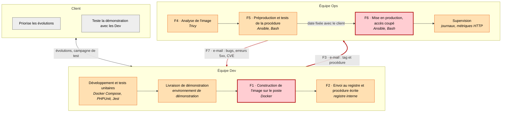

# Rapport d'audit et diagnostic

Amélioration des pratiques DevOps — Projet StarMap

> Statut : à rédiger (structure du modèle fourni par StarSail).

## Synthèse

<!-- À rédiger en dernier : 4 constats et 4 recommandations triées par
priorité, une demi-page. -->

## 1. Introduction et contexte

### 1.1 Présentation de l'entreprise

StarSail Inc. est une entreprise technologique fondée il y a cinq ans,
qui compte une trentaine de collaborateurs. Spécialisée dans la
géolocalisation par traitement d'images astronomiques, elle vise à rendre
la navigation possible dans les zones dépourvues de signal satellite.

Elle est organisée en quatre pôles : Recherche et Développement (R&D),
Développement logiciel (Dev), Opérations et infrastructure (Ops),
Qualité et Amélioration continue (QA).

Son projet phare, StarMap, détermine la position d'un utilisateur à
partir d'une photographie du ciel nocturne. Il est en phase de
pré-production.

StarSail identifie elle-même plusieurs limites dans ses processus :
livraisons manuelles, tests partiels, communication perfectible entre
Dev et Ops, absence d'automatisation complète de la chaîne CI/CD. C'est
dans ce contexte que la Responsable Qualité et Amélioration Continue a
confié cet audit au Responsable DevOps, avec un objectif : améliorer la
qualité, la sécurité et la rapidité des déploiements.

### 1.2 Périmètre de l'audit

L'audit porte sur la chaîne de livraison de StarMap, depuis le poste du
développeur jusqu'à la mise en production : construction, tests,
contrôles de sécurité, déploiement et supervision.

**Périmètre technique**

| Élément | Description |
|---|---|
| Environnement de développement | Postes des développeurs, Docker Compose, PostgreSQL |
| Environnement de test / préproduction (staging) | Serveur Debian « iso-production » ; il est supposé héberger aussi l'environnement de démonstration utilisé avec le client, absent du schéma d'infrastructure |
| Environnement de production | Serveur Debian, conteneurs déployés par Ansible et des scripts Bash, supervision des journaux et des métriques HTTP |
| Outils transverses | Registre Docker interne, Trivy, Git |

**Périmètre organisationnel**

| Acteur | Rôle dans la chaîne |
|---|---|
| Équipe Dev (4 personnes) | Développement, tests, construction des images, rédaction de la procédure de déploiement |
| Équipe Ops (2 personnes) | Analyse de sécurité, tests, déploiement, supervision |
| Client | Priorisation, campagnes de test, choix de la date de mise en production |

**Hors périmètre** : la version mobile de StarMap, citée sans aucune
description ; le modèle d'intelligence artificielle et le pôle R&D ;
l'architecture de l'application (par exemple l'ajout d'un cache Redis) ;
les processus internes du client.

## 2. Méthodologie d'audit

### 2.1 Sources d'information

- Le document « Projet StarMap – Équipes et processus DevOps actuels » :
  présentation de l'entreprise et de l'infrastructure, questionnaires des
  équipes Dev et Ops, schéma d'infrastructure, frise du cycle DevOps et
  schéma des échanges entre le client, les Dev et les Ops (étapes E1 à
  E14).
- La demande de la Responsable Qualité et Amélioration Continue et les
  modèles de rapport fournis.
- Pour la veille : documentations officielles des outils, comparatifs,
  retours d'expérience publiés et dates de fin de support
  (endoflife.date).
- L'expérience de l'auditeur sur des projets antérieurs : analyse des
  images avec Trivy, contrôle des Dockerfile avec Hadolint, audit des
  dépendances, tests de bout en bout avec Cypress et tests de charge avec
  k6 ; puis chaîne CI/CD sous GitHub Actions avec SonarQube, Trivy,
  Gitleaks, Dependabot et mesure des indicateurs DORA.

### 2.2 Démarche d'analyse

L'audit a suivi cinq étapes :

1. Analyse des documents et définition du périmètre.
2. Cartographie du pipeline actuel (diagramme AS-IS).
3. Analyse SWOT, puis priorisation des constats selon leur impact sur la
   qualité, la sécurité et les délais.
4. Veille technologique ciblée sur les besoins identifiés.
5. Formulation de recommandations stratégiques.

Deux règles ont été appliquées tout au long de l'audit :

- **Règle de preuve** : chaque constat cite le document et la page dont
  il provient ; ce qui n'est pas documenté est présenté comme une
  hypothèse.
- **Traçabilité** : chaque point de friction reçoit un numéro (F1, F2…)
  repris dans l'analyse SWOT, les constats et les recommandations.

Les risques de sécurité sont analysés à l'aide de référentiels publics :
l'OWASP Top 10 (risques des applications web) et l'OWASP Top 10 des
risques CI/CD (risques des chaînes d'intégration et de déploiement).

Une IA (Claude, d'Anthropic) a été utilisée comme assistant pour relire
les documents, proposer des formulations et vérifier la cohérence.
L'analyse, les choix et le contenu final ont été décidés par l'auditeur.

## 3. État des lieux technique

### 3.1 Infrastructure et stack technologique

StarMap est hébergé sur deux serveurs Debian, l'un de test et
préproduction, l'autre de production, auxquels s'ajoutent les postes des
développeurs. Les images Docker sont stockées dans un registre interne
partagé et analysées avec Trivy avant chaque déploiement.

Le tableau suivant reprend les technologies citées par les équipes, leur
niveau déclaré dans les questionnaires et l'état de leur fin de support
(source : endoflife.date, consulté le 17/11/2026).

| Technologie | Équipe | Niveau déclaré | Version documentée | Fin de support |
|---|---|---|---|---|
| PHP / Symfony | Dev | Très bon | « PHP 8 » ; Symfony non précisé | PHP 8.0 et 8.1 terminés ; 8.2 jusqu'au 31/12/2026 ; 8.3 à 8.5 maintenus |
| TypeScript / Stimulus | Dev | Bon | non précisée | — |
| Composer / NPM | Dev | Bon | non précisée | Node.js 22, 24 et 26 maintenus |
| PHPUnit / Jest | Dev | Très bon / Moyen | non précisée | — |
| Docker Compose / Docker | Dev / Ops | Moyen / Bon | non précisée | Docker Engine 29 maintenu ; 25.0 jusqu'au 04/12/2026 |
| PostgreSQL | Dev et Ops | Moyen | non précisée | 14 terminé le 12/11/2026 ; 15 à 18 maintenus |
| Debian | Ops | Bon | « stable » | 13 (stable) maintenue ; 12 en support étendu jusqu'au 30/06/2028 |
| Bash / Ansible | Ops | Très bon / Bon | non précisée | — |
| TestInfra / BashUnit | Ops | Bon | non précisée | — |
| Trivy | Ops | non indiqué | non précisée | — |
| Git, VS Code | Dev | non indiqué | — | — |

### 3.2 Processus de développement et déploiement

*Figure 1 – Pipeline actuel de StarMap (AS-IS).*

| Repère | Signification |
|---|---|
| Orange | Étape manuelle |
| Rouge (cadre épais) | Étape manuelle et point de friction majeur |
| Flèche rouge | Passage de relais par e-mail entre Dev et Ops |
| Gris | Intervention du client |
| F1 à F7 | Points de friction, repris dans les sections 4 à 6 |

Une évolution suit le chemin suivant. Le client priorise les évolutions
avec l'équipe Dev, qui développe et lance les tests unitaires sur ses
postes, puis livre une démonstration testée avec le client. L'image
Docker est ensuite construite sur le poste d'un développeur (F1), envoyée
au registre interne et accompagnée d'une procédure écrite (F2). Le tag de
l'image et la procédure sont transmis aux Ops par e-mail (F3). Les Ops
analysent l'image avec Trivy (F4), la déploient en préproduction et
rejouent les tests de la procédure (F5), puis fixent une date avec le
client et mettent en production en coupant l'accès (F6). Les anomalies
détectées par la supervision, les bugs et les alertes de sécurité
reviennent aux Dev par e-mail (F7).

### 3.3 Analyse des workflows Dev et Ops

## 4. Analyse SWOT

### 4.1 Forces

### 4.2 Faiblesses

### 4.3 Opportunités

### 4.4 Menaces

## 5. Constats et besoins identifiés

### 5.1 Problématique 1

### 5.2 Problématique 2

### 5.3 Problématique 3

### 5.4 Problématique 4

### 5.5 Autres constats

## 6. Recommandations stratégiques

### 6.1 Axes d'amélioration prioritaires

### 6.2 Solutions proposées par axe

### 6.3 Justification des orientations

## Conclusion

## Annexes

### Annexe A – Tableau de veille technologique

### Annexe B – Glossaire

### Annexe C – Sources et références
