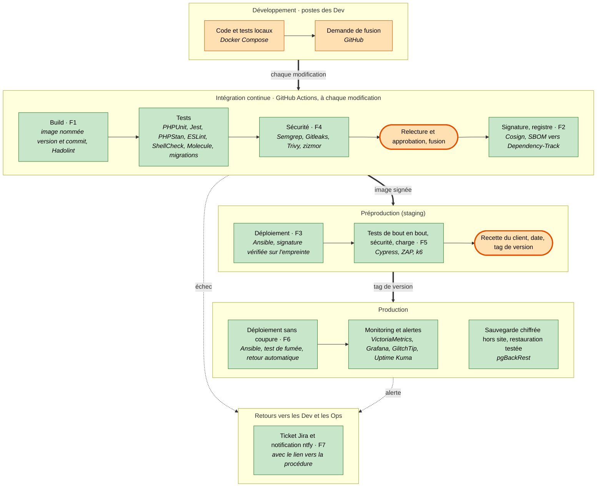
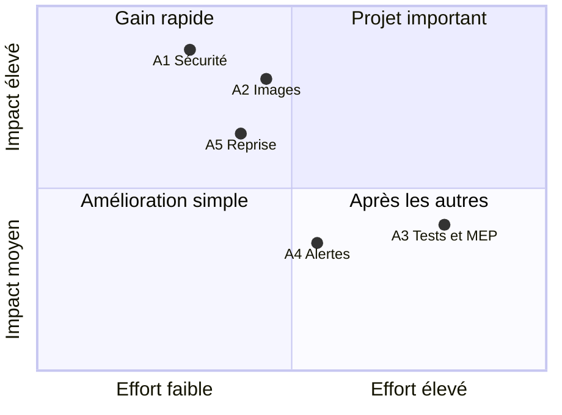
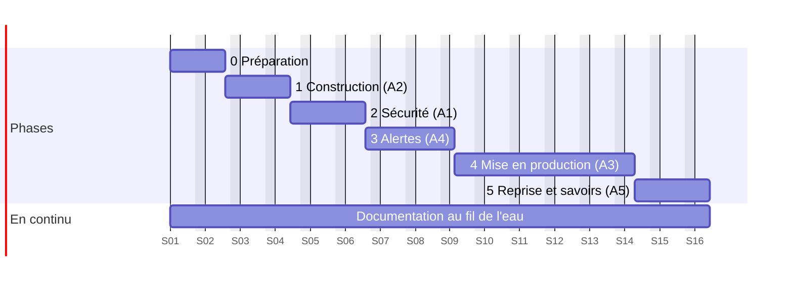

# Spécifications techniques du pipeline modernisé

Amélioration des pratiques DevOps — Projet StarMap

Yohan Bouchet, Responsable DevOps · novembre 2026

| Document | Spécifications techniques du pipeline modernisé |
|---|---|
| Projet | StarMap, StarSail Inc. |
| Version | 1.0 — pour validation |
| Destinataire (validation) | Alyssa, Responsable Qualité et Amélioration Continue |
| Relecture prévue | Lucas (architecture logicielle), Matthieu (sécurité et supervision), Nico (Ansible et déploiement) |
| Documents de référence | Rapport d'audit et diagnostic, version 1.0 ; tableau de veille technologique |
| Diffusion | Interne StarSail |

## Synthèse

Ce document décrit comment passer de la chaîne manuelle décrite dans le
rapport d'audit à un pipeline CI/CD automatisé, sécurisé et mesuré pour
StarMap. Le pipeline cible (section 1) construit, teste, analyse et
signe chaque modification avec GitHub Actions, puis déploie avec Ansible
sans coupure ; seules deux validations restent humaines. Les outils
(section 2) sont open source, à une exception près (GitHub Team) : le
coût est d'environ 45 € HT par mois, plus le stockage des sauvegardes.
La migration (section 3) suit six phases réversibles : 76
jours-personne estimés, soit environ 16 semaines si deux personnes y
consacrent la moitié de leur temps. Dix indicateurs (section 4),
relevés dès la phase 0, mesureront le résultat ; responsabilités et
ressources figurent en section 5.

**Décision attendue** : valider ce plan et son budget, trancher les
hypothèses H1 à H7 (annexe E), puis lancer la phase 0.

<!-- sommaire : inséré à cet endroit par le générateur de PDF -->

## 1. Architecture cible

### 1.1 Vision globale de la solution

Le pipeline modernisé remplace les passages de relais par e-mail par une
chaîne unique : chaque modification suit le même chemin, du poste du
développeur à la production, et chaque étape laisse une trace. Les
personnes gardent les décisions (relecture du code, recette du client,
date de mise en production) ; la chaîne exécute le reste.

Six principes guident les choix :

1. **Automatiser ce qui se répète** : construction, tests, analyses et
   déploiements ; plus aucun tag ni procédure transmis par e-mail.
2. **Construire une fois, déployer partout** : une seule image par
   version, construite par la chaîne, signée, puis promue sans
   changement de la préproduction à la production ; configuration et
   secrets restent hors de l'image (Twelve-Factor App, facteurs III, V
   et X).
3. **Intégrer la sécurité à chaque étape** : contrôles bloquants avant
   la production, secrets chiffrés, droits minimaux (OWASP Top 10
   CI/CD).
4. **Tout décrire en code et le relire** : la chaîne, l'infrastructure
   et la documentation sont versionnées dans Git, et seule la chaîne
   modifie les environnements : deux des quatre principes du GitOps
   (OpenGitOps) ; l'application continue par un agent viendra avec
   Kubernetes.
5. **Avancer par étapes réversibles**, en partant des compétences
   existantes (Docker, Ansible, Trivy, PHPUnit) et d'outils gratuits ou
   open source, à la mesure du budget d'une scale-up.
6. **Mesurer avant et après** : les indicateurs sont relevés en phase 0,
   puis suivis à chaque phase (section 4).

**Priorisation des axes.** Les cinq axes du rapport d'audit sont
repris. Les équipes Dev et Ops citent les trois mêmes problèmes (audit,
section 3.3) : bugs de déploiement, erreurs après la mise en production
et CVE en production ; A1, A3 et A4 y répondent. L'urgence reprend le
niveau des constats (audit, section 5), l'effort celui des outils
retenus (tableau de veille, colonne « Effort d'adoption »).

| Rang | Axe | Urgence | Effort | Impact mesurable | Phase |
|---|---|---|---|---|---|
| 1 | **A1** Intégrer la sécurité dans la chaîne | élevée (W5, W7) | faible à moyen : un serveur pour Dependency-Track | failles critiques en production | 2 |
| 2 | **A2** Automatiser la construction des images | élevée (W1, W2) | moyen : dépôts sur GitHub, runner, Cosign | part des images construites par la chaîne | 1 |
| 3 | **A3** Automatiser les tests et la mise en production | moyenne (W4, W6) | élevé : tests de bout en bout, déploiement sans coupure | fréquence, délai et taux d'échec des mises en production | 4 |
| 4 | **A4** Remplacer les e-mails par des alertes et des tickets | moyenne (W3) | moyen : machine de supervision | délai de prise en charge d'une alerte | 3 |
| 5 | **A5** Garantir la reprise et partager les savoirs | élevée (W10), moyenne (W9) | faible (vérifier les sauvegardes) à moyen (PRA complet) | durée réelle d'une restauration | 0 et 5 |

L'ordre des phases croise l'urgence, l'effort (matrice impact/effort en
annexe F) et les dépendances. A2
ouvre la marche, car les contrôles de A1 et les tests de A3 s'exécutent
dans la chaîne qu'il crée. La vérification des sauvegardes (A5)
commence dès la phase 0 : elle ne dépend de rien et W10 est de niveau
élevé. A4 passe avant la mise en production automatique (A3), pour
qu'un déploiement raté soit détecté et signalé aussitôt.

### 1.2 Diagramme TO-BE du pipeline modernisé



*Figure 1 – Pipeline cible de StarMap (TO-BE), à comparer avec le
pipeline actuel (rapport d'audit, figure 1) ; pleine page en annexe A.*

**Légende** : vert, automatique ; orange, manuel ; orange arrondi à
cadre épais, validation humaine obligatoire ; flèche pleine,
environnement suivant ; pointillés, retour automatique ; F1 à F7,
friction de l'AS-IS supprimée.

Seules deux validations restent humaines : la relecture de la demande
de fusion, puis la recette du client avant le tag de version. Sur des
dépôts privés, l'offre GitHub Team les impose : pas de fusion sans
approbation ni contrôles réussis, production limitée aux tags de
version, tags réservés aux Ops.

Hypothèse H1 (annexe E) : la recette finale du client se fait en
préproduction, sur l'image qui ira en production ; la démonstration en
cours de développement reste possible (environnement non décrit, Dev
p. 5).

### 1.3 Description des étapes du pipeline

| Étape (quand) | Actions automatisées et outils | La chaîne s'arrête si… | Répond à |
|---|---|---|---|
| **Build** (demande de fusion, fusion dans `main`) | Image construite avec des dépendances figées (verrouillage Composer et NPM), nommée avec la version et le commit ; Dockerfile vérifié par Hadolint | Construction en échec ; Dockerfile non conforme | A2 · F1, W2 |
| **Tests** (demande de fusion) | PHPUnit et Jest avec couverture ; PHPStan, ESLint et types TypeScript, ShellCheck, actionlint ; migrations Doctrine rejouées (H2) ; Molecule sur chaque rôle Ansible modifié | Un test échoue ; la couverture baisse | A3 · W4 |
| **Sécurité** (demande de fusion ; chaque nuit pour la production) | Semgrep (code), Gitleaks (secrets), Trivy (image), zizmor (workflows) ; inventaire des composants (SBOM) suivi par Dependency-Track ; Dependabot propose les mises à jour | Faille critique ayant un correctif ; secret ; workflow dangereux | A1 · F4, W5, W7 |
| **Signature et registre** (fusion dans `main`) | Cosign signe l'empreinte de l'image avec la clé de StarSail ; seule la chaîne écrit dans le registre | — | A2 · F2, W1 |
| **Déploiement** (préproduction : chaque fusion ; production : tag créé par un Ops) | Ansible, depuis le runner : vérifie la signature, démarre la nouvelle version à côté de l'ancienne (H3), lance le test de fumée, puis bascule ou revient à la version précédente ; en préproduction, Cypress, ZAP et, avant une version importante, k6 depuis une autre machine | Signature invalide ; test de fumée, de bout en bout ou ZAP en échec | A3 · F3, F5, F6 |
| **Monitoring** (en continu) | VictoriaMetrics et Grafana (5xx, ressources, versions), GlitchTip (erreurs), Uptime Kuma (vue de l'extérieur) ; chaque alerte part en notification ntfy et en ticket Jira, avec sa procédure | — (seuils en section 4) | A4 · F7, W3 |
| **Sauvegarde** (chaque nuit) | pgBackRest : sauvegarde chiffrée, copie hors site ; restauration testée en préproduction sur un volume représentatif | — | A5 · W10 |

**Sécurité intégrée à la chaîne** : secrets hors du code et de l'image
(secrets d'environnement, Ansible Vault), analyses SAST et SCA
bloquantes, images signées puis vérifiées sur leur empreinte, droits
minimaux (jeton en lecture seule, registre écrit par la chaîne seule) ;
détail en 2.3.

## 2. Choix technologiques détaillés et justifiés

Chaque choix applique les critères de l'énoncé : compatibilité avec la
stack (PHP/Symfony, TypeScript, Docker, Ansible, Debian), facilité
d'adoption, coût (licence et infrastructure), maturité et communauté.
Le tableau de veille (46 outils, annexe A du rapport d'audit) détaille
versions, licences, sources et retours d'expérience.

### 2.1 CI/CD

Les trois sont compatibles avec la stack (indépendants du langage,
runner sur Debian, déploiement par Ansible).

| Critère | **GitHub Actions** (retenu) | GitLab CE auto-hébergé (écarté) | Jenkins (écarté) |
|---|---|---|---|
| Adoption | YAML ; service géré, aucun serveur de CI | YAML, mais une forge à installer et maintenir | Serveur et extensions à maintenir |
| Coût | Team : environ 22 € (24 $) par mois pour six personnes ; runners auto-hébergés gratuits | Gratuit ; analyse des dépendances payante | Gratuit ; serveur à héberger |
| Maturité, communauté | Runner MIT (v2.338.2), Dependabot intégré | Mûr, édition communautaire MIT | Très mûr (v2.591), très répandu |
| Limite pour StarSail | Pas open source ; approbation de déploiement réservée à Enterprise, remplacée par des tags réservés aux Ops | Un serveur de plus pour deux Ops | Maintenance trop lourde pour deux Ops |

L'open source est privilégié partout ailleurs ; ici, le service géré
l'emporte, l'équipe Ops ne comptant que deux personnes. Le runner,
interne, va chercher son travail chez GitHub : aucun serveur n'est
ouvert sur Internet.

### 2.2 Tests

PHPUnit et Jest, déjà utilisés, sont lancés par la chaîne avec mesure de
la couverture. **Cypress** (MIT) automatise les tests de bout en bout,
à la demande des Dev (O5) ; **Molecule** (MIT) teste chaque rôle
Ansible et prolonge TestInfra, maîtrisé par les Ops ; **k6** (AGPL-3.0,
usage interne gratuit) mesure les temps de réponse, la charge partant
d'une autre machine que le serveur testé (retour d'expérience).
**Écarté** : Playwright, aussi complet, mais les Dev ont demandé
Cypress.

### 2.3 Sécurité

- **Analyse du code (SAST)** : Semgrep, édition gratuite (moteur
  LGPL-2.1), pour le PHP et le TypeScript ; limite : pas d'analyse entre
  fichiers.
- **Dépendances et image (SCA)** : Trivy, déjà utilisé, devient
  automatique et bloquant, sa version figée par son empreinte depuis sa
  compromission de mars 2026 (T3). Dependabot propose les mises à jour ;
  Dependency-Track (Apache-2.0) suit les failles découvertes après la
  mise en production. Écartés : Grype (doublon de Trivy), Renovate
  (inutile avec Dependabot).
- **Secrets** : Gitleaks (MIT) les bloque dans le code ; ils sont rangés
  dans les secrets d'environnement de GitHub (ceux de la production
  réservés aux tâches qui la visent) et dans Ansible Vault.
  Évolution : OpenBao, coffre-fort trop lourd pour deux serveurs.
- **Signature des images** : Cosign (Apache-2.0), avec une paire de clés
  de StarSail ; le mode « sans clé » écrirait le nom du dépôt privé, du
  workflow et du commit dans un journal public (Rekor).
- **Droits de la chaîne** : jeton de chaque workflow en lecture seule
  par défaut ; runner réservé aux dépôts de StarSail ; zizmor (MIT)
  détecte droits excessifs, actions non figées et déclencheurs dangereux
  (CICD-SEC-4, 5 et 7).
- **Application en fonctionnement (DAST)** : ZAP (Apache-2.0), à chaque
  déploiement en préproduction.

### 2.4 Qualité du code

Analyseurs gratuits, sans serveur, à chaque demande de fusion :
**PHPStan** (MIT, extension Symfony) pour le PHP, **ESLint** avec
typescript-eslint (MIT, mûr, créé en 2013) et le contrôle des types
TypeScript pour le front, **ShellCheck** (Bash), **Hadolint**
(Dockerfile), **actionlint** (workflows). **Option** : oxlint, plus
rapide, déjà utilisé dans un projet antérieur, mais récent (2023).
**Évolution** : SonarQube (édition gratuite limitée à la branche
principale, serveur de plus ; offre en ligne payante au-delà de cinq
membres, code envoyé chez un tiers).

### 2.5 Monitoring et alertes

**VictoriaMetrics, Grafana et Alertmanager** (Apache-2.0 ; Grafana
AGPL-3.0) suivent erreurs 5xx, temps de réponse et ressources, et
déclenchent les alertes, chacune avec le lien vers sa procédure.
VictoriaMetrics, compatible avec Prometheus (son langage de requêtes
reprend PromQL), a été mis en œuvre dans un projet antérieur ;
Prometheus reste une alternative équivalente. **GlitchTip** (MIT)
regroupe les erreurs de l'application ; Sentry est écarté (licence non
open source, installation lourde). **Uptime Kuma** (MIT) vérifie la
disponibilité depuis l'extérieur. Les alertes partent en notification
**ntfy** (open source) et en ticket **Jira** (gratuit jusqu'à dix
utilisateurs) ; **PagerDuty** est une option si une astreinte est créée.

Ces outils tournent hors du réseau de StarSail, sur une machine
virtuelle en France (OVHcloud VPS-4 2027 : 8 cœurs, 24 Go, taille fixée
par Dependency-Track, H5) : elle voit le service comme un client, reste
joignable si la production tombe et reçoit les métriques envoyées par
les serveurs (vmagent), sans port entrant ; accès en HTTPS, comptes
nominatifs.

### 2.6 IaC, déploiement et sauvegarde

**Ansible** (GPL-3.0), maîtrisé par les Ops, reste l'outil de
déploiement et de configuration ; lancé par la chaîne, il vérifie
lui-même le résultat (test de fumée) et les écarts de configuration
(mode `--check --diff`). **pgBackRest** (MIT) sauvegarde PostgreSQL :
sauvegardes complètes et incrémentales, chiffrées, dans plusieurs
dépôts, dont un stockage objet en France ; Barman, proche, est écarté
(sauvegardes incrémentales moins fines). **Évolutions**, après mesure de
la charge : OpenTofu (MPL-2.0) si l'infrastructure passe sur des
machines virtuelles ou un cloud ; K3s, puis Argo CD ou Flux pour un
GitOps complet.

### 2.7 Synthèse des considérations pratiques

| Catégorie | Licences | Coût mensuel estimé (HT) | Compétences | Effort d'intégration |
|---|---|---|---|---|
| CI/CD | Propriétaire (runner MIT) | ≈ 22 € (GitHub Team, 6 personnes) | YAML de GitHub Actions : à acquérir | Moyen : dépôts à migrer, runner |
| Tests | Open source (MIT, BSD, AGPL-3.0 pour k6) | 0 € | PHPUnit et Jest acquis ; Cypress et Molecule à acquérir | Élevé : tests de bout en bout à écrire |
| Sécurité | Open source (Apache-2.0, MIT, LGPL-2.1) | 0 € | Trivy acquis ; les autres à acquérir | Faible à moyen |
| Qualité du code | Open source (MIT, GPL-3.0) | 0 € | Lecture des rapports : faible | Faible |
| Monitoring et alertes | Open source ; Jira et PagerDuty propriétaires | 0 € (Jira gratuit jusqu'à 10 utilisateurs) | Supervision déjà pratiquée par les Ops ; outils nouveaux | Moyen |
| Machine de supervision | — | 23,49 € (19,96 € avec un engagement de 12 mois) | Administration Debian : acquise | Moyen : installation, accès protégés |
| IaC et sauvegarde | Open source (GPL-3.0, MIT) | 0,007 € par Gio stocké (0,70 € pour 100 Gio) ; sortie gratuite | Ansible acquis ; pgBackRest à acquérir | Moyen |
| **Total** | | **≈ 45 € par mois**, plus le stockage des sauvegardes | | |

Prix du 19/11/2026 (OVHcloud ; GitHub au taux BCE du 17/11/2026) ;
volume des sauvegardes à mesurer en phase 0 ; temps des équipes en 5.3.

## 3. Plan de migration

### 3.1 Phases de déploiement

Six phases successives, chacune close par une revue qui décide du
passage à la suivante (critères en 4.2). Charges estimées à trois
points, tâche par tâche (méthode PERT, détail en annexe F) ; durées
pour un jour-personne par jour ouvré, soit deux personnes à mi-temps
(H7).

| Phase | Objectif | Charge (durée) | Livrables | Pilotes |
|---|---|---|---|---|
| 0 Préparation | Mesurer les valeurs de départ, restaurer une sauvegarde, valider H1 à H7, placer les dépôts sur GitHub, installer le runner | 8,8 j-p (≈ 2 sem.) | Valeurs de départ, compte rendu de restauration, dépôts protégés | Responsable DevOps, Nico |
| 1 Construction (A2) | Images construites, nommées et poussées par la chaîne seule ; tests existants rejoués | 8,6 j-p (≈ 2 sem.) | Workflows de construction, registre fermé aux postes | Lucas, Jules (encadré) |
| 2 Sécurité (A1) | Analyses bloquantes, signature, inventaire des composants | 10,9 j-p (≈ 2 sem.) | Contrôles de sécurité, Dependency-Track en service | Matthieu |
| 3 Alertes (A4) | Supervision hors production, alertes en notification et en ticket, une procédure par alerte | 11,5 j-p (≈ 2,5 sem.) | Tableaux de bord, règles d'alerte, procédures | Matthieu, Nico |
| 4 Mise en production (A3) | Tests de bout en bout, déploiement automatique sans coupure, retour automatique | 25,8 j-p (≈ 5 sem.) | Préproduction automatique, première mise en production par tag | Romain, Nico, Lucas |
| 5 Reprise et savoirs (A5) | PRA complet (DMIA et PDMA fixées par la direction), exercice de reprise, base documentaire | 10,5 j-p (≈ 2 sem.) | PRA testé, documentation relue | Nico, Alyssa |

Total : environ 76 jours-personne, soit environ 16 semaines (de 8 à
26 selon les cas optimiste et pessimiste) ; estimation à refaire en
phase 0 avec les équipes, puis à comparer au temps passé en phase 1.

### 3.2 Prérequis techniques et organisationnels

- **Techniques** : GitHub Team et règles des branches et des tags ;
  runner interne hors production (H6) ; machine de supervision et
  stockage objet ; comptes nominatifs ; secrets inventoriés ; clés de
  signature sauvegardées hors ligne.
- **Organisationnels** : budget validé ; temps réservé (H7) ;
  formations (5.3) ; DMIA et PDMA fixées par la direction avant la
  phase 5.
- **Migration des données** : historique Git transféré après Gitleaks ;
  procédures des e-mails reprises dans la base documentaire ; règles de
  supervision recréées. La base reste sur son serveur, mais une
  sauvegarde restaurée et vérifiée précède chaque phase.

### 3.3 Identification des risques et mitigation

| Id | Risque | Probabilité / impact | Parade | Responsable |
|---|---|---|---|---|
| R1 | Coupure pendant une bascule | moyenne / élevé | Préproduction d'abord, retour automatique, ancienne procédure gardée jusqu'à la phase 4 | Nico |
| R2 | Surcharge, résistance au changement | moyenne / élevé | Une phase à la fois, pilotes nommés, formation, gains montrés | Alyssa |
| R3 | Outil incompatible avec la stack | moyenne / moyen | Essai en préproduction, versions inventoriées (phase 0) | Lucas |
| R4 | Migration de la base en échec | faible / élevé | Migrations compatibles, rejouées en préproduction, sauvegarde juste avant | Lucas |
| R5 | Outil de la chaîne compromis (Trivy, mars 2026) | faible / élevé | Versions figées par empreinte, zizmor, droits minimaux | Matthieu |
| R6 | Secret dans l'historique transféré | moyenne / élevé | Gitleaks sur tout l'historique, secrets trouvés remplacés | Matthieu |
| R7 | Trop d'alertes, ignorées | moyenne / moyen | Seuils revus après deux semaines ; une alerte = une action | Matthieu |

### 3.4 Stratégie de rollback

- **Chaque phase est réversible** : les nouveaux outils s'ajoutent à
  côté de l'existant et chaque changement est un commit annulable ; la
  revue de fin de phase sert de point de contrôle.
- **Déploiement** : retour automatique à l'image précédente si le test
  de fumée échoue ; sinon, on redéploie la version précédente, toujours
  au registre avec la même empreinte.
- **Données** : les migrations suivent la règle « étendre puis
  réduire » : la version précédente du code fonctionne sur le nouveau
  schéma, donc revenir au code précédent n'oblige pas à restaurer la
  base. Si des données sont abîmées, pgBackRest restaure la base à
  l'instant précédant la migration, grâce à l'archivage continu du
  journal des transactions ; la perte reste bornée par la PDMA, et la
  décision revient au responsable de la production. Une sauvegarde
  vérifiée précède toute mise en production avec migration.

## 4. Critères d'évaluation et métriques de succès

Valeurs absentes des documents : relevées en phase 0. Cibles garanties
par la chaîne, relatives à cette mesure ou proposées puis validées par
l'équipe ; DORA conseille de suivre la tendance de ses indicateurs
plutôt que d'en faire des objectifs.

### 4.1 Indicateurs de performance (KPIs)

| Id | Indicateur (axe) | Valeur actuelle (source) | Cible | Mesure |
|---|---|---|---|---|
| K1 | Images construites par la chaîne (A2) | 0 % : pas d'intégration continue (p. 3) | 100 % dès la phase 1 | Registre, à chaque version |
| K2 | Durée de la chaîne sur une demande de fusion (A2) | non mesurée (pas de chaîne) | < 10 min | GitHub Actions, chaque semaine |
| K3 | Failles critiques avec correctif, en production (A1) | CVE en production (Dev p. 5, Ops p. 7) ; nombre non mesuré | aucune depuis plus de 7 jours (proposée) | Dependency-Track, chaque jour |
| K4 | Couverture des tests (A3) | non mesurée ; tests « partiels » (p. 2) | mesurée dès la phase 1, jamais en baisse | Rapport de couverture, à chaque fusion |
| K5 | Fréquence des mises en production (A3, DORA) | non mesurée | au moins doublée par rapport à la phase 0 | Tags GitHub, chaque mois |
| K6 | Délai entre un commit et sa mise en production (A3, DORA) | non mesuré | divisé par deux par rapport à la phase 0 | Historique GitHub, chaque mois |
| K7 | Taux d'échec des mises en production (A3, DORA) | non mesuré | au plus celui de la phase 0, puis en baisse | Retours arrière et correctifs urgents, chaque mois |
| K8 | Coupure de service par mise en production (A3) | coupure à chaque mise en production (Ops p. 7) | 0 seconde | Uptime Kuma, à chaque version |
| K9 | Délai de prise en charge d'une alerte critique (A4) | retours par e-mail « souvent avec retard » (p. 3) | < 30 min en heures ouvrées (proposée) | Jira, chaque mois |
| K10 | Durée réelle d'une restauration (A5) | inconnue : aucune sauvegarde décrite | au plus la DMIA fixée par la direction | Exercice de reprise, chaque trimestre |

### 4.2 Critères d'acceptation par phase

| Phase | La phase est réussie quand… |
|---|---|
| 0 | les valeurs de départ sont relevées, une restauration a réussi et a été chronométrée, H1 à H7 sont tranchées |
| 1 | K1 vaut 100 % pendant deux semaines, K2 est sous 10 minutes, le registre est fermé aux postes |
| 2 | toutes les images sont signées et vérifiées, les analyses bloquent, K3 est suivi chaque jour |
| 3 | une alerte de test arrive en notification et en ticket avec sa procédure, même serveur de production arrêté |
| 4 | trois mises en production ont eu lieu sans coupure, un retour arrière automatique a réussi en préproduction, tous les rôles Ansible sont testés |
| 5 | un exercice de reprise dure au plus la DMIA ; la documentation est relue par une personne qui ne l'a pas écrite |

### 4.3 Méthode de suivi et reporting

Un tableau de bord Grafana « Livraison », alimenté par l'historique de
GitHub, réunit K1, K2 et K4 à K8 ; K3 vient de Dependency-Track, K9 de
Jira, K10 des exercices. Revue chaque semaine en équipe, point mensuel
d'une page avec Alyssa ; les indicateurs DORA se lisent sur plusieurs
cycles de livraison, jamais sur une semaine.

## 5. Documentation de mise en place

### 5.1 Responsabilités des équipes

R réalise, A approuve (une seule personne), C consulté, I informé ;
Dev : Sylvain, Romain, Jules ; Matthieu porte aussi la supervision.

| Activité | Dev | Ops (Nico) | Sécurité (Matthieu) | Architecte (Lucas) | Resp. DevOps | Qualité (Alyssa) |
|---|---|---|---|---|---|---|
| Conception de la chaîne, règles des branches | C | C | C | A | R | I |
| Construction et tests | R | I | C | A | C | I |
| Sécurité, secrets, droits | C | C | R | I | A | I |
| Déploiement, infrastructure, sauvegarde | I | R | C | C | A | I |
| Supervision et alertes | I | C | R | I | A | I |
| Indicateurs et revues de phase | C | C | C | C | R | A |

### 5.2 Étapes clés de mise en production

(1) **Préparer l'infrastructure** : GitHub, runner, supervision,
stockage (phases 0 à 2) ; (2) **configurer les outils** : workflows,
analyses, signature, alertes (1 à 3) ; (3) **tester la chaîne** en
préproduction, retour arrière compris (4) ; (4) **déployer
progressivement**, une phase à la fois ; (5) **former les équipes**, un
atelier par phase ; (6) **mettre en production** : première version par
tag, ancienne procédure retirée après la phase 4.

### 5.3 Ressources nécessaires

- **Machines, licences, accès** : voir 2.7 et 3.2 ; droits revus à
  chaque départ.
- **Formation** : cinq ateliers internes d'une demi-journée (GitHub
  Actions, Cypress, Molecule, pgBackRest, sécurité de la chaîne), menés
  par les pilotes avec les parcours officiels (annexe G), sans frais
  externes : environ 15 jours-personne pour six personnes.
- **Temps et budget** : 91 jours-personne (76 de mise en place, 15 de
  formation) ; 45 € HT par mois, plus le stockage (estimations).

### 5.4 Bonnes pratiques et points d'attention

- **Secrets** : jamais dans le code, une image ou un e-mail ; Gitleaks à
  chaque modification ; remplacés après un départ ou un incident.
- **Branches** : branches courtes, fusionnées dans `main` par demande de
  fusion relue et contrôlée ; versions publiées par des tags `vX.Y.Z`
  réservés aux Ops.
- **Retours arrière** : répétés en préproduction à chaque phase ;
  migrations « étendre puis réduire » ; procédure écrite et liée à
  l'alerte.
- **Documentation continue** : dans le dépôt, relue par demande de
  fusion et mise à jour dans le même commit que le changement (Docs as
  Code) ; une procédure par alerte.
- **Tout dans Git** : configuration hors de l'image (Twelve-Factor App,
  facteur III), infrastructure et chaîne décrites en code et appliquées
  par la chaîne seule (principes du GitOps).

### 5.5 Références vers documentation détaillée

Les documentations officielles des outils retenus, les référentiels de
méthode et les parcours de formation recommandés sont regroupés en
annexe G ; la colonne « Sources » du tableau de veille complète la liste.

## Conclusion

Le pipeline proposé remplace une chaîne manuelle, relayée par e-mail,
par une chaîne automatisée, tracée et sécurisée : chaque modification
est construite, testée, analysée et signée, mise en production sans
coupure, et chaque alerte devient un ticket ; dix indicateurs en
mesureront les bénéfices. **Prochaines étapes** : valider ce document
et son budget, trancher H1 à H7, lancer la phase 0. **Facteurs clés de
succès** : du temps réservé aux équipes, une phase à la fois avec sa
revue, des gains mesurés et partagés, la sécurité dès le début.

## Annexes

### Annexe A – Diagramme détaillé des flux

Version pleine page de la figure 1 (légende en section 1.2).


### Annexe B – Exemples de configuration

Extrait illustratif du workflow GitHub Actions, sans prétention
d'exhaustivité (Semgrep, Dependabot et la préproduction sont omis). Il
suppose une étape « test » dans le Dockerfile et des outils installés
sur le runner par Ansible, en versions figées. Les noms suivent la
convention du code (anglais), les commentaires sont en français.

```yaml
# Fichier : .github/workflows/pipeline.yml (extrait illustratif)
# Rôle    : construire, tester et analyser chaque modification ; publier
#           et signer l'image après fusion ; déployer en production sur
#           un tag de version
name: pipeline
on:
  pull_request:
  push:
    branches: [main]
    tags: ["v*"]
permissions: {}                     # aucun droit par défaut
jobs:
  build-test-scan:
    name: Build, test and scan
    if: github.ref_type != 'tag'    # une version n'est jamais reconstruite
    concurrency:                    # une seule exécution par branche
      group: build-${{ github.ref }}
      cancel-in-progress: true
    runs-on: [self-hosted, linux]   # runner interne (H6)
    permissions:
      contents: read
    env:
      IMAGE: ${{ vars.REGISTRY }}/starmap:${{ github.sha }}
    steps:
      # Action figée par l'empreinte de son commit (v7.0.1)
      - uses: actions/checkout@3d3c42e5aac5ba805825da76410c181273ba90b1 # v7.0.1
        with:
          persist-credentials: false  # jeton non conservé sur le disque
      - name: Lint Dockerfile
        run: hadolint Dockerfile
      - name: Scan for secrets
        run: gitleaks dir . --no-banner
      # Étape « test » du Dockerfile : PHPUnit avec couverture
      - name: Unit tests
        run: |
          docker build --target test --tag starmap-test .
          docker run --rm starmap-test
      - name: Build image
        run: docker build --tag "$IMAGE" .
      # Bloque si une faille critique ayant un correctif est trouvée
      - name: Scan image
        run: trivy image --severity CRITICAL --ignore-unfixed --exit-code 1 "$IMAGE"
      # Après fusion seulement : seule la chaîne écrit dans le registre
      - name: Push and sign
        if: github.event_name == 'push'
        env:
          COSIGN_KEY: ${{ secrets.COSIGN_KEY }}
          COSIGN_PASSWORD: ${{ secrets.COSIGN_PASSWORD }}
        run: |
          docker push "$IMAGE"
          digest=$(docker inspect --format '{{index .RepoDigests 0}}' "$IMAGE")
          cosign sign --yes --key env://COSIGN_KEY "$digest"

  deploy-production:
    name: Deploy to production
    if: github.ref_type == 'tag'    # tags réservés aux Ops (ruleset)
    concurrency:                    # jamais deux déploiements à la fois
      group: production
      cancel-in-progress: false
    runs-on: [self-hosted, linux]
    environment: production         # secrets réservés à la production
    permissions:
      contents: read
    env:
      IMAGE: ${{ vars.REGISTRY }}/starmap:${{ github.sha }}
      COSIGN_PUBLIC_KEY: ${{ vars.COSIGN_PUBLIC_KEY }}
    steps:
      - uses: actions/checkout@3d3c42e5aac5ba805825da76410c181273ba90b1 # v7.0.1
        with:
          persist-credentials: false
      # Même image qu'en préproduction, vérifiée sur son empreinte
      - name: Verify signature and deploy
        run: |
          docker pull "$IMAGE"
          digest=$(docker inspect --format '{{index .RepoDigests 0}}' "$IMAGE")
          cosign verify --key env://COSIGN_PUBLIC_KEY "$digest"
          ansible-playbook deploy.yml --extra-vars "image=$digest"
```

Vérification le 19/11/2026 : actionlint 1.7.12, aucune erreur ;
zizmor 1.32.0, aucune alerte au niveau par défaut. Au niveau
« auditeur », il signale le runner auto-hébergé (choix assumé, dépôt
privé, H6) et la clé de signature utilisée hors d'un environnement
dédié : à la mise en œuvre, ranger cette clé dans un environnement
« registre » réservé à la branche `main`.

### Annexe C – Glossaire

Termes propres à ce document ; les autres (CI/CD, CVE, DORA, GitOps,
SAST, SBOM, SCA, runner, tag, test de fumée…) sont définis dans le
glossaire du rapport d'audit (annexe B).

| Terme | Définition |
|---|---|
| Couverture des tests | Part du code exécutée par les tests automatisés. |
| DAST | *Dynamic Application Security Testing* : test de sécurité de l'application en fonctionnement (ici, ZAP). |
| Empreinte (digest) | Identifiant calculé à partir du contenu d'une image : il change si un seul octet change, contrairement à un tag. |
| Environnement GitHub | Cible de déploiement (préproduction, production) avec ses propres secrets et ses règles d'accès. |
| « Étendre puis réduire » | Règle de migration de base : ajouter d'abord sans casser l'ancien code, ne retirer l'ancien schéma qu'à la version suivante. |
| Jour-personne | Travail d'une personne pendant une journée. |
| KPI | *Key Performance Indicator* : indicateur clé de performance. |
| PERT | Estimation à trois points : (optimiste + 4 × probable + pessimiste) ÷ 6. |
| Proxy inverse | Serveur placé devant l'application, qui reçoit le trafic et peut le basculer d'une version à l'autre. |
| RACI | Matrice des responsabilités : réalise, approuve, consulté, informé. |
| Restauration à un instant donné | Restauration d'une base telle qu'elle était à une date et une heure précises, grâce au journal des transactions. |
| Retour arrière (rollback) | Retour à la version précédente après un échec. |
| Ruleset | Règle GitHub qui protège des branches ou des tags (relecture, contrôles, création réservée). |
| Signature d'image | Preuve cryptographique que l'image a été produite par la chaîne et n'a pas été modifiée (ici, Cosign). |
| Test de bout en bout | Test qui reproduit le parcours d'un utilisateur dans l'application complète (ici, Cypress). |
| Twelve-Factor App | Douze règles de conception d'une application facile à déployer (12factor.net). |
| Workflow | Fichier qui décrit les tâches de la chaîne GitHub Actions et leurs déclencheurs. |

### Annexe D – Matrice de traçabilité

Chaque constat du rapport d'audit (points de friction F et faiblesses W)
est suivi jusqu'à sa solution, sa mesure et sa phase.

| Constat (audit) | Problématique | Axe | Étape (1.3) | Outils (section 2) | Indicateur | Phase |
|---|---|---|---|---|---|---|
| F1 · W1 Images construites sur les postes | P2 | A2 | Build | GitHub Actions, Hadolint | K1, K2 | 1 |
| F2 · W7 Images envoyées au registre par les Dev | P1, P2 | A1, A2 | Signature et registre | Cosign, registre fermé aux postes | K1 | 1, 2 |
| F3 · W2, W3 Tag et procédure transmis par e-mail | P2, P4 | A2, A3 | Build (nommage), Déploiement | Nommage automatique, Ansible | K5, K6 | 1, 4 |
| F4 · W5 Trivy manuel, résultats non suivis | P1 | A1 | Sécurité | Trivy, Dependency-Track | K3 | 2 |
| F5 · W4 Tests manuels, refaits deux fois | P3 | A3 | Tests, Déploiement | PHPUnit, Jest, Cypress, ZAP, k6, Molecule | K4 | 1, 4 |
| F6 · W6 Mise en production avec coupure | P3 | A3 | Déploiement | Ansible, test de fumée, Uptime Kuma | K7, K8 | 4 |
| F7 · W3 Retours par e-mail | P4 | A4 | Monitoring | VictoriaMetrics, Grafana, GlitchTip, ntfy, Jira | K9 | 3 |
| W7 SAST, SCA et secrets non prouvés | P1 | A1 | Sécurité | Semgrep, Gitleaks, Dependabot, zizmor | K3 | 2 |
| W8 Versions non inventoriées | P1 | A1 | Sécurité | SBOM, Dependency-Track, Dependabot | K3 | 0, 2 |
| W9 Savoirs portés par peu de personnes | P4 | A5 | Toutes | Base documentaire, ateliers | Critère de la phase 5 | 5 |
| W10 Aucune sauvegarde, serveur unique | 5.5 de l'audit | A5 | Sauvegarde | pgBackRest, stockage objet | K10 | 0, 5 |

### Annexe E – Registre des hypothèses à valider

| Id | Hypothèse | Pourquoi un doute | Qui valide | Avant |
|---|---|---|---|---|
| H1 | La recette finale du client se fait en préproduction, sur l'image qui ira en production | Environnement de démonstration cité, mais absent du schéma d'infrastructure (questionnaire Dev, p. 5) | Lucas et Nico, avec le client | Phase 4 |
| H2 | Le schéma de la base évolue par les migrations Doctrine, méthode documentée par Symfony | Gestion du schéma non décrite | Lucas | Phase 1 |
| H3 | Un proxy inverse placé devant l'application permet de basculer le trafic d'une version à l'autre | Aucun proxy inverse décrit (schéma d'infrastructure, p. 8) | Nico | Phase 4 |
| H4 | Les dépôts peuvent être placés sur GitHub | Hébergement actuel du code non décrit ; seul « Git » est cité (p. 4) | Lucas et Alyssa | Phase 0 |
| H5 | Une machine de supervision hors du réseau de StarSail, en France, est acceptable (journaux et erreurs de l'application y sont stockés) ; une seule machine suffit à la charge de StarSail (Dependency-Track conseille une base dédiée en production) | Aucune règle d'hébergement ni volume de données décrits | Matthieu et Alyssa | Phase 3 |
| H6 | Une machine du réseau interne, autre que le serveur de production, peut accueillir le runner | Seuls deux serveurs sont décrits (p. 2) | Nico | Phase 0 |
| H7 | Deux personnes consacrent chacune la moitié de leur temps à la phase en cours | Disponibilité des équipes non décrite | Alyssa | Phase 0 |

### Annexe F – Supports de planification



*Figure 2 – Matrice impact/effort des axes (section 1.1). Positions
qualitatives : l'impact suit le niveau des constats (rapport
d'audit, section 5), l'effort celui des outils retenus (tableau de
veille).*

**Estimation des charges** (jours-personne ; O optimiste, M probable,
P pessimiste ; PERT = (O + 4M + P) ÷ 6). Ces chiffres sont une première
estimation, à refaire en phase 0 avec les équipes.

| Phase | Tâche | O | M | P | PERT |
|---|---|---|---|---|---|
| 0 | Valeurs de départ des indicateurs | 1 | 2 | 4 | 2,2 |
| 0 | Vérification des sauvegardes et restauration | 1 | 2 | 4 | 2,2 |
| 0 | Validation des hypothèses H1 à H7 | 1 | 1 | 2 | 1,2 |
| 0 | Dépôts sur GitHub (historique passé à Gitleaks), règles | 1 | 2 | 4 | 2,2 |
| 0 | Runner auto-hébergé | 0,5 | 1 | 2 | 1,1 |
| 1 | Workflow de construction, nommage, Hadolint | 2 | 3 | 6 | 3,3 |
| 1 | Tests existants rejoués, couverture | 1 | 2 | 4 | 2,2 |
| 1 | Registre fermé aux postes | 0,5 | 1 | 2 | 1,1 |
| 1 | Atelier GitHub Actions, documentation | 1 | 2 | 3 | 2 |
| 2 | Analyses bloquantes, tri des premiers résultats | 2 | 4 | 8 | 4,3 |
| 2 | Dependabot | 0,5 | 1 | 2 | 1,1 |
| 2 | Signature Cosign et vérification | 1 | 2 | 4 | 2,2 |
| 2 | Machine de supervision, Dependency-Track | 2 | 3 | 6 | 3,3 |
| 3 | VictoriaMetrics, vmagent, Grafana, Alertmanager | 2 | 4 | 7 | 4,2 |
| 3 | GlitchTip dans l'application | 1 | 2 | 4 | 2,2 |
| 3 | Uptime Kuma, ntfy, Jira | 1 | 2 | 3 | 2 |
| 3 | Règles d'alerte et procédures | 2 | 3 | 5 | 3,2 |
| 4 | Tests Cypress des parcours principaux | 5 | 8 | 15 | 8,7 |
| 4 | ZAP et k6 | 1 | 2 | 4 | 2,2 |
| 4 | Molecule sur tous les rôles | 3 | 5 | 10 | 5,5 |
| 4 | Déploiement automatique sans coupure, retour automatique | 4 | 7 | 12 | 7,3 |
| 4 | Migrations compatibles, testées | 1 | 2 | 4 | 2,2 |
| 5 | PRA : DMIA, PDMA, sauvegardes chiffrées multiples | 2 | 3 | 6 | 3,3 |
| 5 | Exercice de reprise | 1 | 2 | 3 | 2 |
| 5 | Base documentaire, guide d'arrivée | 3 | 5 | 8 | 5,2 |
| | **Total** | **40,5** | **71** | **132** | **76,1** |



*Figure 3 – Planning indicatif des phases, en semaines comptées depuis
le début de la phase 0 (un jour-personne par jour ouvré, hypothèse H7).*

### Annexe G – Références et formations

Liens consultés le 19/11/2026.

**Référentiels et méthodes** : OWASP Top 10 CI/CD
<https://owasp.org/www-project-top-10-ci-cd-security-risks/> ;
Twelve-Factor App <https://12factor.net/> ; OpenGitOps
<https://opengitops.dev/> ; indicateurs DORA
<https://dora.dev/guides/dora-metrics-four-keys/> ; Docs as Code
<https://www.writethedocs.org/guide/docs-as-code/>.

**Documentation des outils** :

- GitHub Actions <https://docs.github.com/en/actions> ; environnements
  <https://docs.github.com/en/actions/reference/workflows-and-actions/deployments-and-environments> ;
  rulesets
  <https://docs.github.com/en/repositories/configuring-branches-and-merges-in-your-repository/managing-rulesets/about-rulesets> ;
  Dependabot <https://docs.github.com/en/code-security/dependabot>
- Semgrep <https://semgrep.dev/docs/> ; Cosign
  <https://docs.sigstore.dev/cosign/signing/overview/> ; zizmor
  <https://docs.zizmor.sh/> ; ZAP
  <https://www.zaproxy.org/docs/docker/baseline-scan/> ;
  Dependency-Track <https://dependencytrack.github.io/docs/>
- Cypress <https://docs.cypress.io/> ; k6
  <https://grafana.com/docs/k6/latest/> ; Molecule
  <https://ansible.readthedocs.io/projects/molecule/> ; Ansible
  <https://docs.ansible.com/>
- VictoriaMetrics (vmagent)
  <https://docs.victoriametrics.com/victoriametrics/vmagent/> ; GlitchTip
  <https://glitchtip.com/documentation/install> ; pgBackRest
  <https://pgbackrest.org/user-guide.html> ; migrations Symfony
  <https://symfony.com/doc/current/doctrine.html>

**Formations recommandées** (parcours officiels, support des ateliers de
5.3) : GitHub Skills <https://skills.github.com/> ; Cypress
<https://learn.cypress.io/> ; guides de Molecule, de pgBackRest et de
zizmor (ci-dessus).

**Prix** : catalogue public d'OVHcloud
<https://api.ovh.com/1.0/order/catalog/public/vps?ovhSubsidiary=FR> ;
offres GitHub <https://github.com/pricing> ; taux de change de la BCE
<https://data.ecb.europa.eu/>.
