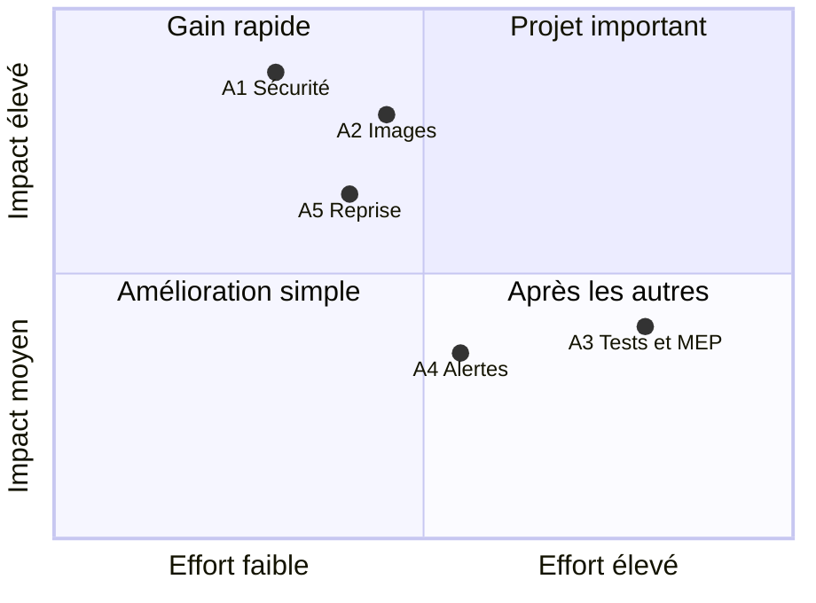
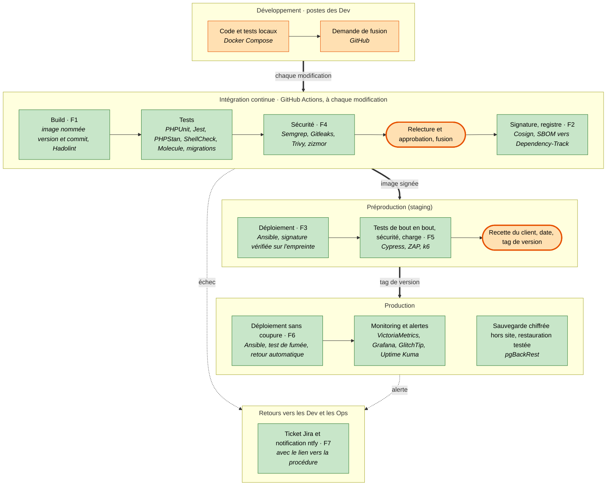

# Spécifications techniques du pipeline modernisé

Amélioration des pratiques DevOps — Projet StarMap

Yohan Bouchet, Responsable DevOps · novembre 2026

| Document | Spécifications techniques du pipeline modernisé |
|---|---|
| Projet | StarMap, StarSail Inc. |
| Version | 1.0 — en cours de rédaction |
| Destinataire (validation) | Alyssa, Responsable Qualité et Amélioration Continue |
| Relecture prévue | Lucas (architecture logicielle), Matthieu (sécurité et supervision), Nico (Ansible et déploiement) |
| Documents de référence | Rapport d'audit et diagnostic, version 1.0 ; tableau de veille technologique |
| Diffusion | Interne StarSail |

<!-- sommaire : inséré à cet endroit par le générateur de PDF -->

## 1. Architecture cible

### 1.1 Vision globale de la solution

Le pipeline modernisé remplace les passages de relais par e-mail par une
chaîne unique : chaque modification suit le même chemin, du poste du
développeur à la production, et chaque étape laisse une trace. Les
personnes gardent les décisions (relecture du code, recette du client,
date de mise en production) ; la chaîne exécute le reste.

Six principes guident les choix :

1. **Automatiser ce qui se répète** : construction, tests, analyses et
   déploiements ; plus aucun tag ni procédure transmis par e-mail.
2. **Construire une fois, déployer partout** : une seule image par
   version, construite par la chaîne, signée, puis promue sans
   changement de la préproduction à la production ; la configuration et
   les secrets restent hors de l'image (facteurs III, V et X de la
   méthode Twelve-Factor App).
3. **Intégrer la sécurité à chaque étape** : contrôles bloquants avant
   la production, secrets chiffrés, droits minimaux (OWASP Top 10
   CI/CD).
4. **Tout décrire en code et le relire** : la chaîne, l'infrastructure
   et la documentation sont versionnées dans Git, et seule la chaîne
   modifie les environnements. Ce sont les deux premiers principes du
   GitOps (OpenGitOps) ; les deux autres, un agent qui applique en
   continu l'état décrit, arriveront avec Kubernetes (évolution).
5. **Avancer par étapes réversibles**, en partant des compétences
   existantes (Docker, Ansible, Trivy, PHPUnit) et d'outils gratuits ou
   open source, à la mesure du budget d'une scale-up.
6. **Mesurer avant et après** : les indicateurs sont relevés en phase 0,
   puis suivis à chaque phase (section 4).

**Priorisation des axes.** Les cinq axes du rapport d'audit sont
repris. Les équipes Dev et Ops citent les trois mêmes problèmes (audit,
section 3.3) : bugs de déploiement, erreurs après la mise en production
et CVE en production ; A1, A3 et A4 y répondent. L'urgence reprend le
niveau des constats (audit, section 5), l'effort celui des outils
retenus (tableau de veille, colonne « Effort d'adoption »).

| Rang | Axe | Urgence | Effort | Impact mesurable | Phase |
|---|---|---|---|---|---|
| 1 | **A1** Intégrer la sécurité dans la chaîne | élevée (W5, W7) | faible à moyen : un serveur pour Dependency-Track | failles critiques en production | 2 |
| 2 | **A2** Automatiser la construction des images | élevée (W1, W2) | moyen : dépôts sur GitHub, runner, Cosign | part des images construites par la chaîne | 1 |
| 3 | **A3** Automatiser les tests et la mise en production | moyenne (W4, W6) | élevé : tests de bout en bout, déploiement sans coupure | fréquence, délai et taux d'échec des mises en production | 4 |
| 4 | **A4** Remplacer les e-mails par des alertes et des tickets | moyenne (W3) | moyen : machine de supervision | délai de prise en charge d'une alerte | 3 |
| 5 | **A5** Garantir la reprise et partager les savoirs | élevée (W10), moyenne (W9) | faible (vérifier les sauvegardes) à moyen (PRA complet) | durée réelle d'une restauration | 0 et 5 |

*Figure 1 – Matrice impact/effort des axes. Positions qualitatives :
l'impact suit le niveau des constats, l'effort celui des outils
retenus.*

L'ordre des phases croise l'urgence, l'effort et les dépendances. A2
ouvre la marche, car les contrôles de A1 et les tests de A3 s'exécutent
dans la chaîne qu'il crée. La vérification des sauvegardes (A5)
commence dès la phase 0 : elle ne dépend de rien et W10 est de niveau
élevé. A4 passe avant la mise en production automatique (A3), pour
qu'un déploiement raté soit détecté et signalé aussitôt.

### 1.2 Diagramme TO-BE du pipeline modernisé

*Figure 2 – Pipeline cible de StarMap (TO-BE), à comparer avec le
pipeline actuel (rapport d'audit, figure 1).*

| Repère | Signification | Repère | Signification |
|---|---|---|---|
| Vert | Étape automatique | Flèche pleine | Passage à l'environnement suivant |
| Orange | Étape manuelle | Flèche pointillée | Retour automatique vers les équipes |
| Orange arrondi, cadre épais | Validation humaine obligatoire | F1 à F7 | Point de friction de l'AS-IS supprimé par l'étape |

Une modification passe d'un environnement à l'autre sans intervention,
sauf aux deux validations humaines : la relecture de la demande de
fusion, puis la recette du client avant le tag de version. Les dépôts
étant privés, ces validations reposent sur les règles de l'offre GitHub
Team : pas de fusion sans approbation ni contrôles réussis, production
limitée aux tags de version, création de ces tags réservée aux Ops.
L'image, identifiée par son empreinte, passe de la préproduction à la
production sans être reconstruite.

Hypothèse H1, à valider avec les Dev (annexe E) : la recette finale du
client se fait en préproduction, sur l'image qui ira en production ; la
démonstration en cours de développement reste possible, mais son
environnement n'est pas décrit (questionnaire Dev, p. 5).

### 1.3 Description des étapes du pipeline

| Étape | Quand | Actions automatisées et outils | La chaîne s'arrête si… | Répond à |
|---|---|---|---|---|
| Build | Chaque demande de fusion ; fusion dans `main` | Image construite avec des dépendances figées (fichiers de verrouillage Composer et NPM), nommée avec la version et l'identifiant du commit ; Dockerfile vérifié par Hadolint | Construction en échec ; Dockerfile non conforme | A2 · F1, W2 |
| Tests | Chaque demande de fusion | PHPUnit et Jest, avec mesure de la couverture ; PHPStan, ShellCheck, actionlint ; migrations Doctrine rejouées sur une base de test (H2) ; Molecule sur chaque rôle Ansible modifié | Un test échoue ; la couverture baisse | A3 · W4 |
| Sécurité | Chaque demande de fusion ; chaque nuit pour les versions en production | Semgrep (code), Gitleaks (secrets), Trivy (image), zizmor (workflows) ; inventaire des composants (SBOM) envoyé à Dependency-Track, qui signale les failles découvertes après coup ; Dependabot propose les mises à jour | Faille critique ayant un correctif ; secret détecté ; workflow dangereux | A1 · F4, W5, W7 |
| Signature et registre | Fusion dans `main` | Cosign signe l'empreinte de l'image avec la clé de StarSail ; seule la chaîne écrit dans le registre | — | A2 · F2, W1 |
| Déploiement | Préproduction : après chaque fusion. Production : tag de version créé par un Ops | Ansible, depuis le runner auto-hébergé : vérifie la signature, démarre la nouvelle version à côté de l'ancienne (H3), lance le test de fumée, puis bascule le trafic ou revient à la version précédente. En préproduction : Cypress, ZAP et, avant une version importante, k6 lancé depuis une autre machine | Signature invalide ; test de fumée, de bout en bout ou ZAP en échec | A3 · F3, F5, F6 |
| Monitoring | En continu | VictoriaMetrics et Grafana (erreurs 5xx, ressources, mises en production marquées), GlitchTip (erreurs de l'application), Uptime Kuma (disponibilité vue de l'extérieur) ; chaque alerte part en notification ntfy et en ticket Jira, avec le lien vers sa procédure ; outils hébergés hors du serveur de production | — (alerte selon les seuils de la section 4) | A4 · F7, W3 |
| Sauvegarde | Chaque nuit ; restauration testée régulièrement | pgBackRest : sauvegarde chiffrée, copie hors site ; restauration testée en préproduction sur un volume représentatif | — | A5 · W10 |

**Secrets.** Jamais dans le code ni dans l'image : ils sont rangés dans
les secrets d'environnement de GitHub (ceux de la production ne sont
accessibles qu'aux tâches qui la visent) et dans Ansible Vault. La clé
de signature y est aussi ; Ansible garde la clé publique pour vérifier.

**Droits.** Chaque workflow reçoit un jeton en lecture seule par défaut,
élargi tâche par tâche ; le runner auto-hébergé ne sert qu'aux dépôts
de StarSail.

## 2. Choix technologiques détaillés et justifiés

### 2.1 CI/CD

### 2.2 Tests

### 2.3 Sécurité

### 2.4 Qualité du code

### 2.5 Monitoring

### 2.6 Synthèse des considérations pratiques

## 3. Plan de migration

### 3.1 Phases de déploiement

### 3.2 Prérequis techniques et organisationnels

### 3.3 Identification des risques et mitigation

### 3.4 Stratégie de rollback

## 4. Critères d'évaluation et métriques de succès

### 4.1 Indicateurs de performance (KPIs)

### 4.2 Critères d'acceptation par phase

### 4.3 Méthode de suivi et reporting

## 5. Documentation de mise en place

### 5.1 Responsabilités des équipes

### 5.2 Étapes clés de mise en production

### 5.3 Ressources nécessaires

### 5.4 Bonnes pratiques et points d'attention

### 5.5 Références vers documentation détaillée

## Conclusion

## Annexes

### Annexe A – Diagramme détaillé des flux

### Annexe B – Exemples de configuration

### Annexe C – Glossaire

### Annexe D – Matrice de traçabilité

### Annexe E – Registre des hypothèses à valider

| Id | Hypothèse | Pourquoi un doute | Qui valide | Avant |
|---|---|---|---|---|
| H1 | La recette finale du client se fait en préproduction, sur l'image qui ira en production | Environnement de démonstration cité, mais absent du schéma d'infrastructure (questionnaire Dev, p. 5) | Lucas et Nico, avec le client | Phase 4 |
| H2 | Le schéma de la base évolue par les migrations Doctrine, méthode documentée par Symfony | Gestion du schéma non décrite | Lucas | Phase 1 |
| H3 | Un proxy inverse placé devant l'application permet de basculer le trafic d'une version à l'autre | Aucun proxy inverse décrit (schéma d'infrastructure, p. 8) | Nico | Phase 4 |
| H4 | Les dépôts peuvent être placés sur GitHub | Hébergement actuel du code non décrit ; seul « Git » est cité (p. 4) | Lucas et Alyssa | Phase 0 |
